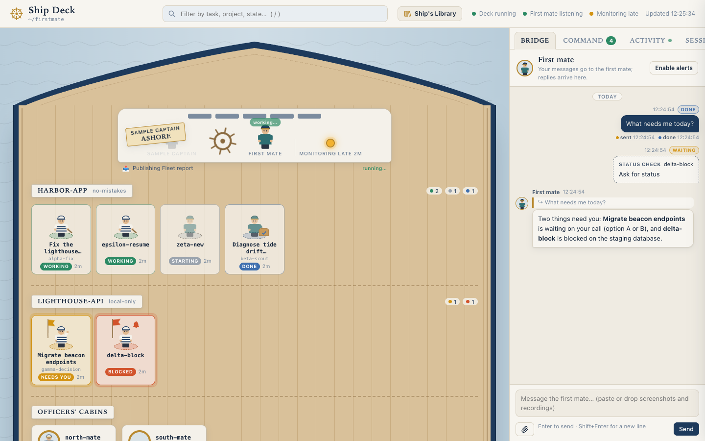
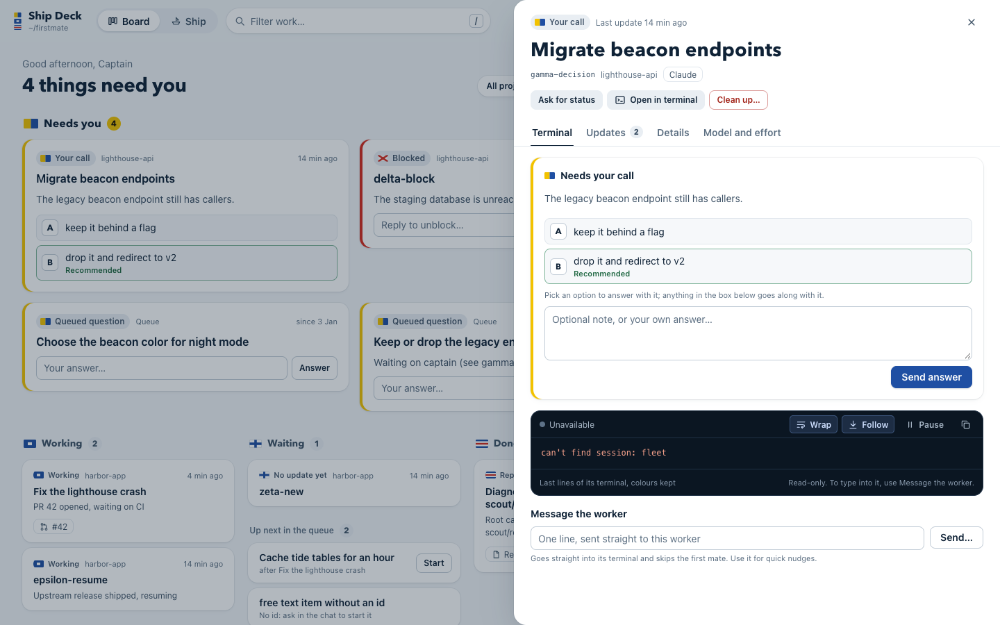
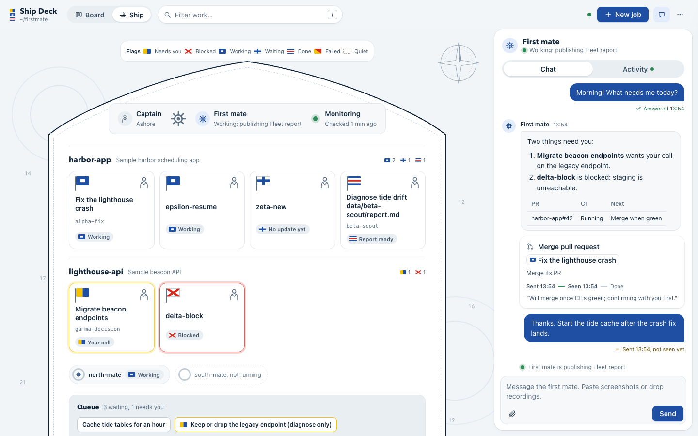

# Ship Deck

**One live board for your fleet of AI coding agents: see who needs you, answer
them, and talk to the agent running the fleet, all from your browser.**

## Why you'd want it

Running many AI coding workers at once quickly turns into terminal juggling.
Ship Deck fixes that:

- **No more tab-hopping.** Every worker is on one board instead of spread over
  a dozen terminal windows.
- **Know who needs you.** Workers waiting on a decision, blocked or failed rise
  to a **Needs you** column; the rest sit under **Working**, **Waiting** or
  **Done**.
- **Answer without a terminal.** Pick a worker's option or type a reply right
  on its card. Merge, clean up or start new work with one click.
- **See what's happening.** A live peek at each worker's terminal and a feed of
  what the lead agent is doing right now.
- **Share what your agent knows.** Teammates' agents pick up your skills and
  notes automatically, so the whole team works with the same context.

## What it does

- **Board**: every worker grouped by what it needs from you, with the task
  title, latest update, pull request and tool. Filter by project or search.
- **Ship view**: the same fleet drawn as a nautical chart, one berth per worker
  flying its status flag.
- **Chat with the lead agent** (the "first mate"): send messages and read its
  markdown replies.
  Paste, drop or attach screenshots and screen recordings; videos are turned
  into stills the agent can read.
- **One-click actions**: answer a decision, ask for status, merge a PR, clean
  up one or all finished workers, start a new job or a queued item. Each is a
  message the first mate acts on (and confirms anything irreversible); Ship
  Deck never does these itself.
- **Worker details**: the live terminal (last 80 lines, with colours), every
  status update, the brief and data files, a direct one-line message to the
  worker, and the command to resume its Claude Code session.
- **Per-worker model and effort**: switch a Claude worker's model or effort
  live from an allow-list; other tools get it on relaunch.
- **Library**: the first mate's context files, memory and skills, rendered as
  readable pages.
- **Activity feed**: what the first mate is doing and saying, live.
- **Team context sharing** (opt-in): grant a teammate by email and choose
  what to share: your skills, your notes and memory, or both. Their own Ship
  Deck pulls what you granted and installs it for their agent as read-only
  skills, automatically. When you change a skill, the update reaches them;
  they cannot change your copy; secrets are scrubbed before anything leaves
  your machine; and every view and sync is logged. Revoke, or let the grant
  expire, and it is removed from their machine.
- **Read-only board view** (opt-in): let a teammate watch your board in their
  browser. They can look, never send.
- **Comfort**: status is a signal flag, a colour and a word (readable without
  colour); light and dark themes that pass WCAG AA; keyboard shortcuts (press
  `?`); browser notifications on request.

## Screenshots







*(Screenshots use the fabricated sample fleet in `test/fixtures/home`.)*

## Quick start

You need **Node.js 18+** and **git**. Everything else is set up for you:

```sh
git clone https://github.com/aryanbhandari047/ship-deck.git ~/ship-deck
sh ~/ship-deck/bin/install.sh     # macOS/Linux, no sudo, safe to re-run
ship-deck                         # opens http://127.0.0.1:4747/
```

The installer adds the tools your agents need (the Claude Code and GitHub
CLIs among them) when it can, or prints the one command to run. It sets up the
agent engine, [firstmate](#inspiration), at `~/firstmate`, copies the app to
`~/.ship-deck/app` and adds a `ship-deck` command. Add `--autostart` to start
it at login, or `--home DIR` to keep the engine elsewhere.

Without the installer, run it straight from the clone: `npx .` or
`node server.js --home ~/firstmate`.

Try it on the sample fleet first, without touching a real one:

```sh
cp -R test/fixtures/home /tmp/ship-deck-sample
node server.js --home /tmp/ship-deck-sample --orders-dir /tmp/ship-deck-orders
```

- Full setup, including teaching your first mate to read the
  chat: [docs/TEAMMATE-SETUP.md](docs/TEAMMATE-SETUP.md)
- Flags, home detection, the message contract, sharing, security and more:
  [docs/REFERENCE.md](docs/REFERENCE.md)
- Letting other agents read a shared library: [docs/AGENT-LIBRARY.md](docs/AGENT-LIBRARY.md)

## Share with your team

Sharing goes through a small relay service you deploy once for your team
(steps in [`relay/README.md`](relay/README.md)).

1. **Turn on sharing**: start with `ship-deck --share --share-relay <relay URL>`
   and sign in from the share button in the top bar.
2. **Invite by email**: add a teammate and pick how long they get access
   (1, 7 or 30 days). New people get a one-time invite link to send them.
3. **Choose what to share**: the board, live updates, terminals, and your
   skills or notes. Skills and notes reach their agent automatically once
   their own Ship Deck is signed in.

The full walkthrough, from both sides: [docs/TEAMMATE-SETUP.md](docs/TEAMMATE-SETUP.md)
(steps 8 and 9) and the Sharing section of [docs/REFERENCE.md](docs/REFERENCE.md#sharing-read-only-opt-in).

## How it works

Ship Deck is a small Node server that runs on your own machine and is
reachable only from it. It reads your agents' status, queue, projects and
briefs without changing them, refreshing every 3 seconds, and shows each
worker's live terminal. Your chat messages and actions are handed to the lead
agent, which does the work and reports back on the board; the only things sent
straight to a worker are a one-line message or a model/effort change you make
yourself. There are no dependencies and no build step. Nothing leaves your
machine unless you turn on sharing. Exact files, commands and limits: [docs/REFERENCE.md](docs/REFERENCE.md).

## Inspiration

Ship Deck is built for and inspired by
[**firstmate**](https://github.com/kunchenguid/firstmate), the orchestration
layer it runs on: firstmate's first mate dispatches and supervises the coding
workers, and Ship Deck is the captain's view of that fleet.

## Tests

```sh
npm test
```
