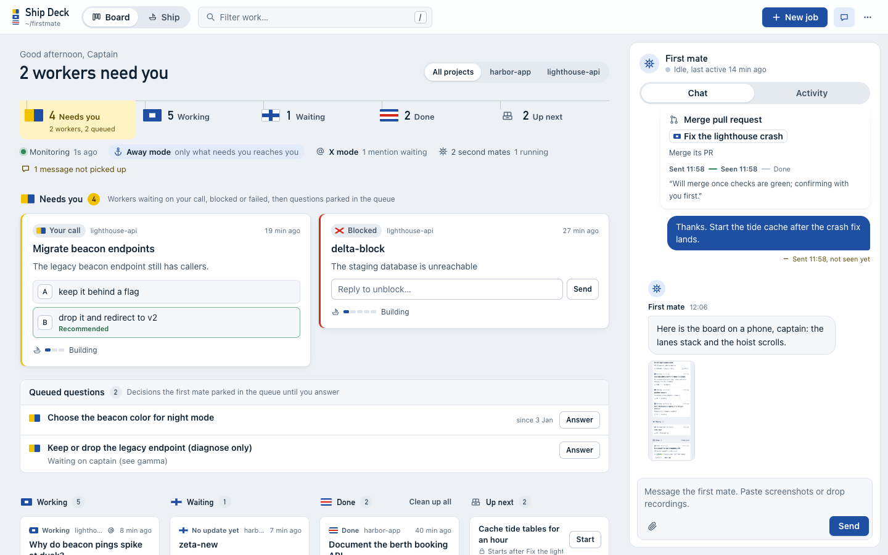
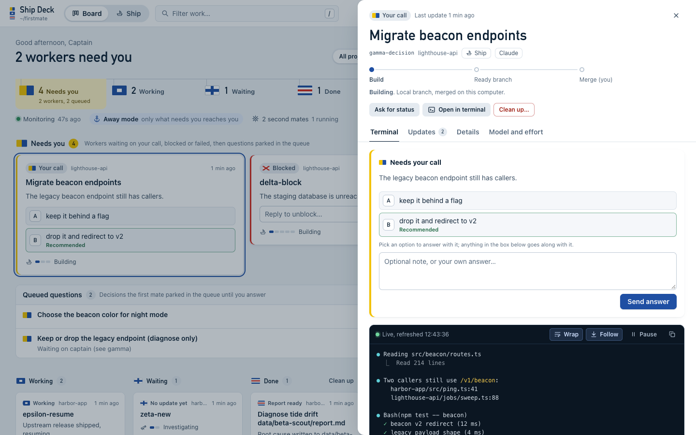
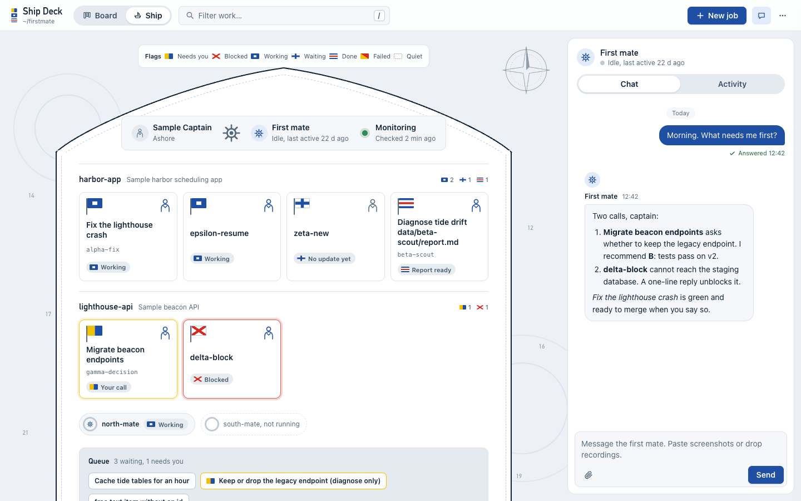
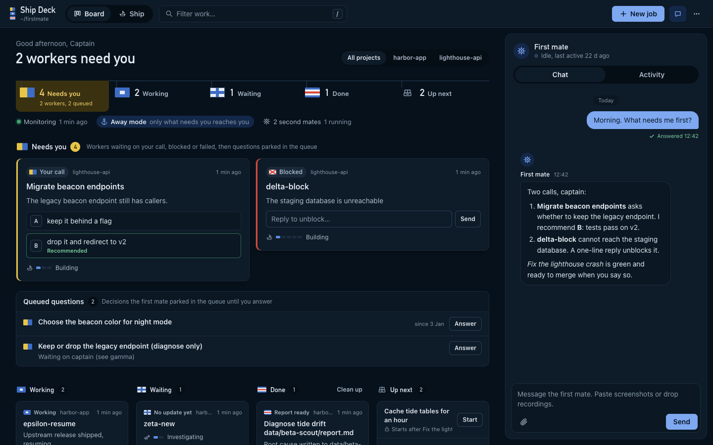
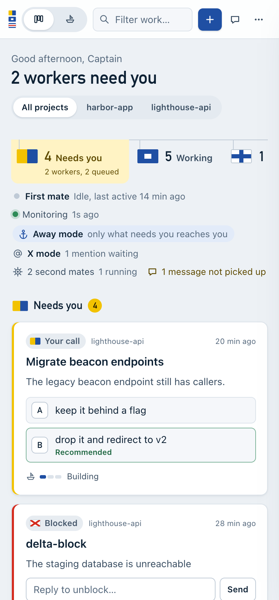
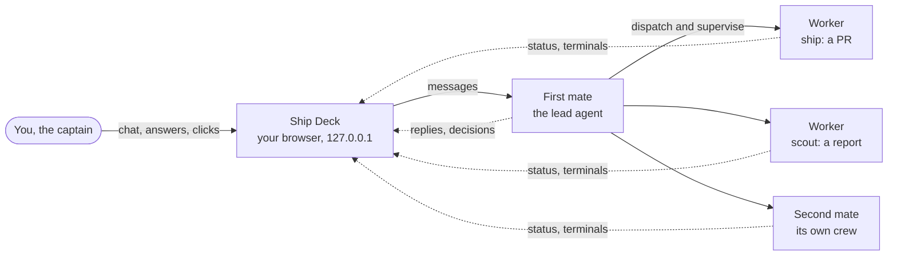
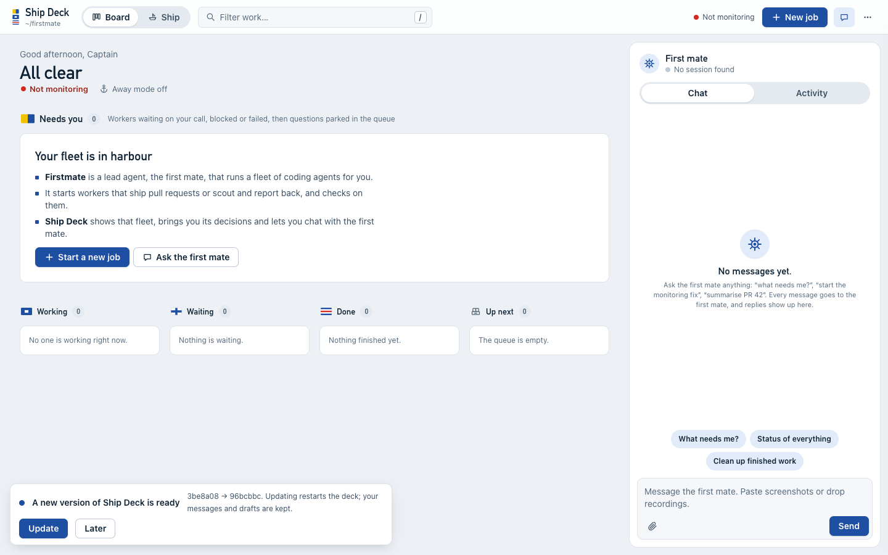

# Ship Deck

**Run a crew of coding agents from one browser tab.**

Running one coding agent is easy. Running five means five terminals, and the
one that needs your answer is always the one you are not looking at. Ship
Deck puts the whole crew on one live board. What needs you comes first, and
you answer it right there.



## Start in 60 seconds

macOS or Linux. Paste this in a terminal:

```sh
curl -fsSL https://raw.githubusercontent.com/aryanbhandari047/ship-deck/main/bin/install.sh | sh
```

One command does it all. It installs what is missing, sets up the agent
engine, starts Ship Deck and opens it in your browser. When it finishes it
prints the deck's URL and three things to try:

1. **Start your first mate** in a new terminal: `cd ~/firstmate && claude`
2. **Say hello** in the chat on the deck. Your first mate answers there.
3. **Ask for real work**, like *"add github.com/you/app and fix the login
   bug"*. Workers show up on the board. Anything that needs you rises to
   **Needs you**.

It is safe to run again. It needs no sudo, apart from one optional macOS
password prompt (see [Stay awake](#stay-awake-with-the-lid-closed-macos)).
[What the installer does](#what-the-installer-does) · [Options](#install-options)

## Why you'd want it

- **No more terminal hopping.** Every agent, on every project, sits on one
  live board. One tab replaces the stack of terminals.
- **Run many agents in parallel; see who needs you first.** Each task gets its
  own agent and clean git worktree. Anything blocked or waiting on your call
  rises to **Needs you**; the rest stay quiet.
- **Answer in place.** Pick an option or type a reply on the card. Open a
  worker for its question, its delivery track and its live terminal.
- **Your teammates' know-how works for you.** When a teammate shares, their
  skills and notes install for your agent automatically, and it can ask their
  library questions and get cited answers.
- **Build your own library, and share it.** Keep your skills and notes in one
  place. Share them with your team by email, read-only, with private notes
  never leaving your machine.
- **Stay in the terminal if you like.** You never need the UI. Work with your
  lead agent in its terminal and the board keeps itself in sync.
- **Close the lid; the work goes on.** On macOS, keep-awake keeps your agents
  running with the lid closed. One switch turns it off.
- **One command to set up, one to update.** The installer brings everything
  you need; `ship-deck update` (or the **Update** button) keeps you current
  and never discards your changes.



The **Ship** view shows the same crew as a nautical chart, grouped by project.
Status is always a flag, a colour and a word, so it reads without colour too.
Light and dark themes pass WCAG AA, and the layout works on a phone.



<p>
  
  
</p>

*Screenshots use the made-up sample fleet in `test/fixtures/home`.*

## How it works



- **[Firstmate](https://github.com/kunchenguid/firstmate)** is the engine. You
  talk to one agent, the first mate. It starts workers, each in its own
  terminal and its own git worktree, and supervises them to the end.
- **Ship Deck** is your window onto it. It reads the fleet's status files
  (it never changes them), shows each worker's terminal, and hands your
  messages to the first mate. The first mate does the work and reports back
  on the board.
- Everything runs on your machine. Ship Deck listens on 127.0.0.1 only and
  has no dependencies and no build step. Nothing leaves your computer unless
  you turn on [sharing](#share-with-your-team).

## What firstmate brings

Ship Deck shows all of it:

| Firstmate | On the deck |
| --- | --- |
| **One lead agent.** You talk to the first mate; it dispatches, supervises and only escalates real decisions. | The chat on every view, and an **Activity** feed of what it is doing right now. |
| **Parallel workers.** Each task gets its own agent, terminal and clean git worktree, so work on one repo never collides. | One card per worker, its live terminal, a direct one-line message, its model and effort (switch them live). |
| **Ship or scout.** Ship tasks deliver a change; scout tasks investigate and write a report. | **New job** asks which one. A scout's report is in its details. |
| **A pipeline to green PRs.** Projects ship through a validation pipeline (review, tests, lint, docs, CI), straight to a PR, or as a local merge. | Each card shows its delivery track and the PR's checks. Merge with one click; the first mate confirms first. |
| **Decisions come to you.** Workers that need a call wait for you instead of guessing. | **Needs you** on top, with the options as buttons and the recommended one marked. |
| **Away mode.** Step away and only what needs you reaches you. | The conditions line shows it, with monitoring and messages not picked up yet. |
| **Second mates.** For bigger fleets: second mates with their own homes and crews. | Listed under the board, running or not. |
| **Sharing.** Your skills and notes, for your teammates' agents. | **More > Share your deck**: invite by email, choose what to share. |
| **Keep-awake.** Close the lid; your agents keep working. | One switch in **Settings > You**. |

Merging, cleaning up and starting work are messages the first mate acts on.
Ship Deck never merges or deletes anything by itself.

## Update

Click **Update** when the deck says a new version is ready, or run:

```sh
ship-deck update
```

It fast-forwards your copy, reinstalls with the choices you already made,
restarts the deck and prints what changed. If you edited your copy or its
branch has diverged, it stops and changes nothing. It never resets or
discards anything.



Installed before updates existed? Run this once; after that, use the button or
`ship-deck update`:

```sh
git -C ~/ship-deck pull && sh ~/ship-deck/bin/install.sh
```

After an update, restart your first mate (type `/exit`, then
`cd ~/firstmate && claude`) so newly shared skills load.

## Share with your team

> **Beta:** sharing is new and may change.

Invite a teammate by email and choose what they get, for 1, 7 or 30 days.
Nothing is shared until you sign in and add someone. Every item is read-only,
except **suggest**, which only proposes, and **answer**, which lets a trusted
teammate answer for you:

| Share | What they get |
| --- | --- |
| **board**, **updates**, **model** | Worker titles, status, projects, PR links; the last status lines; model and effort. |
| **skills**, **notes** | Your skills and notes, installed for their agent as read-only skills. Private notes never leave your machine. |
| **terminal**, **chat** | 40 scrubbed terminal lines per worker; the first mate's chat, labels only. |
| **ask** | Their agent asks a question and gets up to 3 cited passages from your skills and notes. |
| **suggest** | They propose an answer to a worker waiting on you. You decide; their note is never sent. |
| **answer** | "Answer for me": they answer anything in Needs you, including queued questions. Click **Ask for help** on a card to notify them (their page and, through your first mate, a Slack DM); answers you asked for go to the worker at once, others wait 5 seconds so you can cancel. Never merges, clean-ups, new jobs, chat, settings or items marked destructive, irreversible or security-sensitive. |

Secrets are scrubbed before anything leaves your machine. Every view and sync
is logged. Revoke someone, or let the grant expire, and it is removed from
their machine. A team pool lets you offer a skill to everyone, once an
approver accepts it.

Sharing goes through a small relay you deploy once for your team
([`relay/README.md`](relay/README.md)). Installs turn it on with the Keychain
relay. `--no-share` turns it off and later installs remember that. Full
walkthrough: [docs/TEAMMATE-SETUP.md](docs/TEAMMATE-SETUP.md) (steps 8 and 9).

## Stay awake with the lid closed (macOS)

Closing the lid puts a Mac to sleep, and your agents with it. On a first
install the installer offers to keep the Mac awake with the lid closed. It is
on by default (press Enter, or `n` to skip), and macOS asks for your password
once. It uses macOS's own setting (`pmset disablesleep`); Ship Deck never sees
or stores your password.

Turn it off in **Settings > You**, or with `ship-deck awake off`
(`ship-deck awake status` shows it). Keep the Mac on its charger while it is
on, and don't put it in a bag closed: it can get hot.

## Details

### What the installer does

- Checks for Node.js 18+ (installs it with Homebrew when missing), git, tmux,
  the GitHub CLI and the `claude` CLI. It installs what it can without sudo
  and prints the one command to run for anything left.
- Sets up firstmate at `~/firstmate` when you have none, and teaches it to read
  Ship Deck's chat. An existing firstmate is never changed; a folder there
  that is not firstmate stops the install untouched.
- Copies Ship Deck to `~/.ship-deck/app`, keeps its source in
  `~/.ship-deck/src` (for updates), and adds a `ship-deck` command in
  `~/.local/bin` (plus a PATH line in your shell rc file when needed).
- Starts Ship Deck in the background and opens it. A re-run restarts it on
  the new version. Logs go to `~/.ship-deck/server.log`.
- Tells you what is still to do, like `gh auth login`.

`ship-deck` opens the running deck (or starts one). `ship-deck --help` lists
every flag.

### Install options

Add flags after `sh -s --`, for example
`curl -fsSL <url> | sh -s -- --autostart`:

| Flag | Does |
| --- | --- |
| `--autostart` | Start Ship Deck at login (LaunchAgent on macOS, systemd user unit on Linux). |
| `--home DIR` | Keep firstmate in another folder (set up there when missing; remembered). |
| `--no-start` | Install only; start it later with `ship-deck`. |
| `--no-share` | Turn sharing off (remembered until `--share`). |
| `--no-keep-awake` | macOS: leave normal sleep alone. |
| `--no-edit-path` | Don't touch your shell rc file; it prints the PATH line instead. |

From a clone instead: `git clone https://github.com/aryanbhandari047/ship-deck.git ~/ship-deck && sh ~/ship-deck/bin/install.sh`.

### Try it without an install

The sample fleet, on a spare port, without touching a real one:

```sh
cp -R test/fixtures/home /tmp/ship-deck-sample
node server.js --home /tmp/ship-deck-sample --port 4800 --orders-dir /tmp/ship-deck-orders --no-open
```

### Remove it

```sh
rm -rf ~/.ship-deck ~/.local/bin/ship-deck
```

That also deletes your chat history and attachments. With `--autostart`,
also remove the login item (steps in
[docs/TEAMMATE-SETUP.md](docs/TEAMMATE-SETUP.md#removing-ship-deck)).
`~/firstmate` is yours to keep.

### More

- [docs/TEAMMATE-SETUP.md](docs/TEAMMATE-SETUP.md): the full setup guide, both sides of sharing.
- [docs/REFERENCE.md](docs/REFERENCE.md): every flag, view, file, the message contract, sharing, security and limits.
- [docs/AGENT-LIBRARY.md](docs/AGENT-LIBRARY.md): letting other agents read a shared library.
- Tests: `npm test` (no dependencies, no build step).

Ship Deck is built for and inspired by
[**firstmate**](https://github.com/kunchenguid/firstmate): its first mate runs
the crew, and Ship Deck is the captain's view of it.
