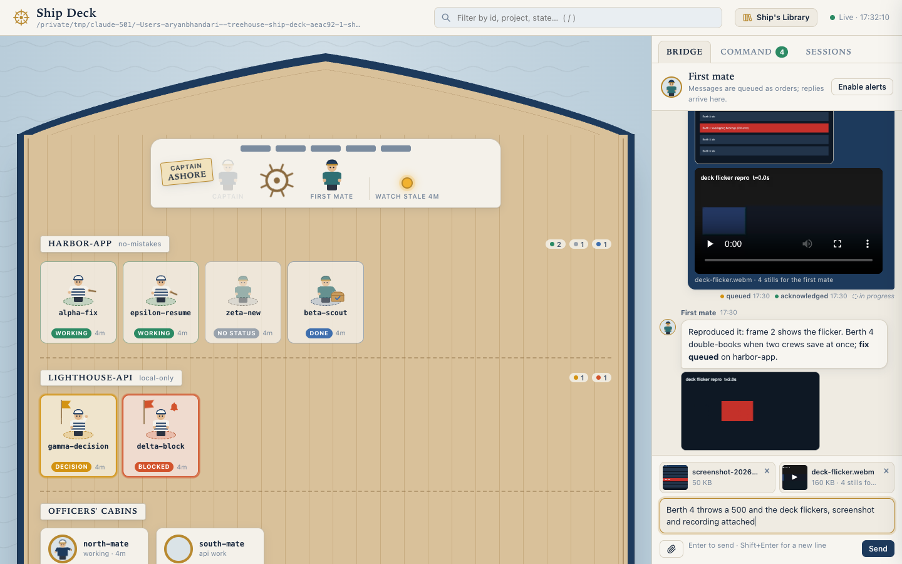
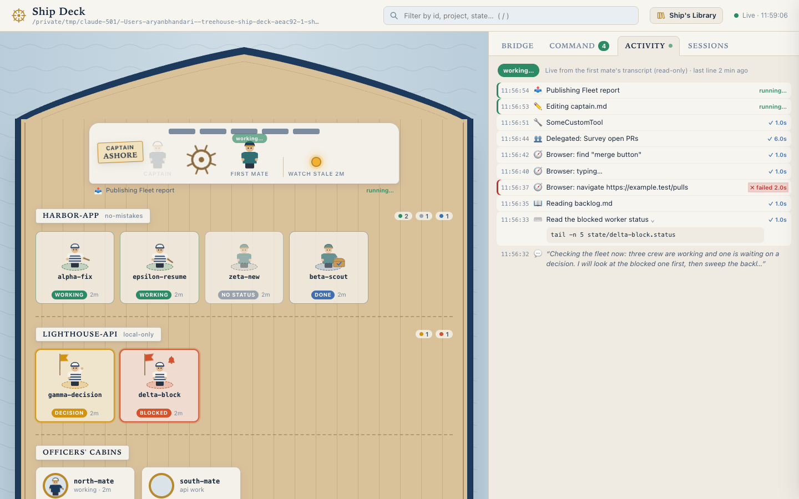

# Ship Deck

A local, live GUI of the firstmate fleet, drawn as a top-down ship deck. Every
in-flight task is a crew member at a deck station; the bridge shows the captain,
the first mate at the helm and the watch lamp; queued backlog items sit in the
cargo hold as crates. Inspired by [Munder Difflin](https://github.com/HarnessMD/munder-difflin).

It is the captain's control surface: everything day-to-day happens here, and
every live Claude Code session stays resumable from a terminal. It is
**read-only against the fleet home**: it never writes, renames or deletes
anything there, with one exception: each new order appends one wake line to
`state/ship-deck-inbox.status` (see the order contract; `--no-wake` disables it). The captain's actions are deliberately narrow:

- **Bridge chat**: free-text messages to the first mate, queued as `chat`
  orders; the first mate's replies come back through `bin/orders.js reply` and
  render in the same thread (safe markdown, PR links open in a new tab).
  Screenshots and screen recordings can be pasted, dropped or attached
  ([Attachments](#attachments), below).
- **Orders to the first mate**: decisions, clean up, merge, status, new jobs,
  backlog starts and answers, bulk clean up, config changes. All are *queued*
  as JSON lines in `~/.ship-deck/orders.jsonl`; Ship Deck never acts on them.
- **Terminal peek**: the crew drawer shows the last 80 lines of the worker's
  tmux pane (`tmux capture-pane -p -t <window> -S -80`), refreshed every 2 s.
- **Message a worker**: one line (max 2000 chars, confirmed in the UI) sent with
  exactly `FM_HOME=<home> <home>/bin/fm-send.sh <window> <message>`.
- **Live config** (claude workers only): `/effort <level>` or `/model <model>`
  through the same fm-send call, built server-side from an allow-list.

Those fm-send calls (plus `tmux capture-pane` and `tmux list-windows`) are the
only commands it runs, always via `execFile` with a fixed argv. The client only
sends crew ids, library keys and allow-listed values; the tmux window always
comes from `state/<id>.meta`. The only files it writes are in `~/.ship-deck/`
(dir 0700, files 0600), attachments included. It reads `~/.claude/` (transcripts, skills) but never
writes there.






*(Screenshots use the fabricated fixture home in `test/fixtures/home`.)*

## Run

Node 18+ with no install step and no dependencies:

```sh
node server.js                      # reads FM_HOME, default /Users/aryanbhandari/Desktop/AI/firstmate
node server.js --home /path/to/home --port 4747
FM_HOME=/path/to/home node server.js
node server.js --no-tmux            # skip the tmux liveness probe
node server.js --stale-days 14      # stale threshold, default 7 (or SHIP_DECK_STALE_DAYS)
node server.js --orders-dir DIR     # orders queue, default ~/.ship-deck (or SHIP_DECK_ORDERS_DIR)
node server.js --memory-dir DIR     # first mate memory shown in the Ship's Library
node server.js --claude-dir DIR     # Claude Code data dir, default ~/.claude (transcripts, skills)
node server.js --no-wake            # don't append wake lines to <home>/state/ship-deck-inbox.status
sh bin/start.sh [server flags...]   # start in the background unless the port already answers
```

Open <http://127.0.0.1:4747/>. The server binds to `127.0.0.1` only. The page
polls `GET /api/fleet` every 3 s and animates changes in place (no reload). If
the server goes away the page shows a "reconnecting" banner and keeps retrying
(backing off to 15 s); drafts are kept in `localStorage` per field.

Try it on the sample fleet without touching the real one:

```sh
cp -R test/fixtures/home /tmp/ship-deck-sample
node server.js --home /tmp/ship-deck-sample --port 4748 --orders-dir /tmp/ship-deck-orders
echo "done: sample finished" >> /tmp/ship-deck-sample/state/delta-block.status   # updates within ~3 s
```

### Start at login (macOS)

`bin/start.sh` checks the port first, so it is safe to run repeatedly; it logs
to `~/.ship-deck/server.log`. A LaunchAgent example (not installed by Ship Deck;
save it as `~/Library/LaunchAgents/local.ship-deck.plist` and run
`launchctl load ~/Library/LaunchAgents/local.ship-deck.plist`):

```xml
<?xml version="1.0" encoding="UTF-8"?>
<!DOCTYPE plist PUBLIC "-//Apple//DTD PLIST 1.0//EN" "http://www.apple.com/DTDs/PropertyList-1.0.dtd">
<plist version="1.0">
<dict>
  <key>Label</key><string>local.ship-deck</string>
  <key>ProgramArguments</key>
  <array>
    <string>/bin/sh</string>
    <string>/Users/aryanbhandari/Desktop/AI/firstmate/projects/ship-deck/bin/start.sh</string>
  </array>
  <key>EnvironmentVariables</key>
  <dict><key>PATH</key><string>/opt/homebrew/bin:/usr/local/bin:/usr/bin:/bin</string></dict>
  <key>RunAtLoad</key><true/>
</dict>
</plist>
```

## Orders and the Bridge: the first mate's contract

Three append-only JSON-lines logs in `~/.ship-deck/` (or `$SHIP_DECK_ORDERS_DIR`):

| File | Written by | Line |
| --- | --- | --- |
| `orders.jsonl` | Ship Deck | `{id, ts, kind, target, text, status:"pending", ...payload}` |
| `orders-ack.jsonl` | first mate (`ack`) | `{id, ts, status, note}`, status `acknowledged`, `done` or `declined` |
| `replies.jsonl` | first mate (`reply`) | `{id, ts, kind:"reply", inReplyTo, text, attachments?}` |

Order ids look like `o-20261012T160000123Z-ab12` and reply ids `r-...`; both
sort by time. An order's lifecycle is its acks: pending (no ack) ->
acknowledged -> done or declined; the UI shows every step with its note.
`target` is a crew id (or `null`), `text` is what the captain wrote or a default.
`sessions.json` (resume ids, below) lives in the same directory.

Fast lane: every new order (any kind) also appends exactly one line to
`<FM_HOME>/state/ship-deck-inbox.status`, so the first mate's status monitor
wakes within one poll instead of waiting for the slow `orders.jsonl` check:
`message: <order-id> <kind> <first 80 chars of text, whitespace collapsed>`.
The file is append-only (O_APPEND, 0644 if created, never truncated, renamed or
deleted); a failed write is logged and the order still queues. It is only a
wake signal: `orders.jsonl` stays the source of truth and `bin/orders-check.sh`
the backstop. `--no-wake` turns it off.

| kind | target | payload | meaning |
| --- | --- | --- | --- |
| `chat` | - | `text` (multi-line, max 4000; may be empty when there are attachments), optional `attachments` | Free-text message from the Bridge. Answer with `reply`. |
| `decision` | crew id | `option` (`A`-`H` or `null`), `text` | Answer to a needs-decision/blocked worker; `text` is `(B) <option text>` plus any note, or a free answer. |
| `answer` | crew id | `text` | Legacy free-text answer (older UI). |
| `status` | crew id | - | Ask the worker for a status update. |
| `merge` | crew id | - | Merge its PR. Irreversible: confirm with the captain first. |
| `cleanup` | crew id | - | Tear the worker down. Irreversible: confirm first. |
| `cleanup-done` | - | `targets`: crew ids that were done when queued | Clean up all finished crew. Irreversible: confirm first. |
| `new-task` | - | `project` (from `data/projects.md`), `taskKind` (`ship` or `scout`), optional `harness`, `model` (absent = first mate default), `effort` (`auto` = first mate decides), `text` | Dispatch a new job. |
| `backlog-start` | - | `item` (backlog id), `text` | Start this queued backlog item. |
| `backlog-answer` | - | `item` (backlog id), `option`, `text` | The captain's answer to a Captain's Call item. |
| `config` | crew id | `field` (`effort` or `model`), `value`, `applied` | Record of a config change. `applied:true` = already sent live (`/effort`/`/model` via fm-send; takes effect from the worker's next turn); `applied:false` = apply it when relaunching the worker. Only created by `POST /api/config`. |
| `order` | optional | `text` | Legacy free-text order. |

The UI asks for confirmation before every order; for `merge`, `cleanup` and
`cleanup-done` it says plainly that the first mate will still confirm before
acting.

```sh
node bin/orders.js list [--pending] [--json]       # pending = no ack yet; payload shown under each order
node bin/orders.js ack <id> <acknowledged|done|declined> [note...]
node bin/orders.js reply <order-id> [--ack done] "text"   # reply in the Bridge (optionally ack too)
node bin/orders.js reply - "text"                  # unprompted message from the first mate
node bin/orders.js reply <order-id|-> --file report.md    # long markdown (--file - reads stdin)
node bin/orders.js reply <order-id|-> --attach shot.png [--attach demo.mp4] "text"   # with images/videos
node bin/orders.js thread [--limit 30] [--json]    # the conversation as the captain sees it
node bin/orders.js sessions [--json]               # recorded resume commands
sh bin/orders-check.sh    # prints "ship-deck: N new captain order(s)" or nothing
```

Replies are markdown (max 64 KB): paragraphs, lists, **bold**, `code`, fenced
code, tables and links. Ship Deck escapes all HTML and only links `http(s)`
URLs (bare PR URLs autolink and open in a new tab). New replies raise an unread
badge and, if the captain enabled alerts, a browser notification; so do new
"needs the captain" items.

`bin/orders-check.sh` is self-contained POSIX sh + awk, meant to be copied into
firstmate's watcher as a custom wake check. It counts every new order of any
kind, chat included (replies never wake it), and remembers the newest order id
it has reported in `~/.ship-deck/orders-check.cursor`. All three scripts honour
`SHIP_DECK_ORDERS_DIR`.

## Attachments

The Bridge composer takes images and videos three ways: paste (Cmd+V of a
screenshot), drag and drop onto the Bridge, or the paperclip button. Each one
shows as a thumbnail with a remove (×) button; up to 10 per message. A message
may be attachments only.

| kind | accepted (by magic bytes, server-side) | max each |
| --- | --- | --- |
| image | png, jpeg, gif, webp | 20 MB |
| video | mp4, mov (QuickTime), webm | 200 MB |

Anything else (pdf, svg, mkv, a text file renamed `.png`...) is refused with a
clear message. The client's MIME type and file name are never trusted: the
stored name gets the extension of the sniffed type.

**Protocol.** Each file is uploaded as soon as it is added:

1. `POST /api/attachments?name=<file name>` with the raw file as the body
   (`X-Ship-Deck: 1`, any non-form `Content-Type`, from 127.0.0.1 only) ->
   `{ok, attachment: {id, kind, name, mime, size}}`. `id` is a UUID.
2. For a video, the browser draws stills with `<video>` + `<canvas>` (one
   every 2 s, at most 40 spread over the whole video, JPEG up to 1280 px wide)
   and uploads each as `POST /api/attachments?parent=<id>&name=frame-0001.jpg`,
   then `name=index.json` (`{duration, width, height, frames: [{file, t}]}`;
   the server rewrites it from known fields and adds the video path). The
   chip shows "extracting frames N/M" and Send stays disabled until it ends.
   Claude can read images but not video, so the stills are what the first mate
   looks at. If the browser cannot decode the video, it is sent without
   stills and the chip says so.
3. `POST /api/orders {kind:"chat", text, attachments:[id, ...]}`: the server
   checks every id and records `attachments: [{id, kind, name, path, size,
   mime}]` on the order, where `path` is the absolute local file the first mate
   reads; videos also carry `frames` (the stills dir, or `null`) and
   `frameCount`.

**Where files live:** `~/.ship-deck/attachments/<uuid>/<safe-name>` (plus
`.meta.json`, and `frames/frame-NNNN.jpg` + `frames/index.json` for videos);
dirs 0700, files 0600. `node bin/orders.js list --pending` prints each path
(and the frames dir) under the message. Uploads removed before sending stay on
disk until deleted by hand; any `attachments/<uuid>` dir no order or reply
names is safe to delete.

**Viewing:** the thread shows images as thumbnails (click to enlarge, Esc
closes) and videos as inline players, served by `GET /api/attachments/<id>`
with `Range` support (206/416). It only serves the regular file recorded in
that attachment's `.meta.json`, addressed by UUID; symlinks and any other path
are refused. Responses carry `nosniff` and a sandbox CSP.

**First mate replies:** `reply --attach <path>` (repeatable) checks each file
the same way before writing anything, copies it into the attachments dir and
renders it in the thread (videos from replies get no stills).

## Per-worker configuration

Each crew drawer shows the worker's harness, model and effort: the values in
`state/<id>.meta`, overridden by the latest applied `config` order (unapplied
ones show as "on relaunch"). The pickers are allow-listed server-side
(`lib/config.js`); anything else is rejected:

| harness | effort | model | live |
| --- | --- | --- | --- |
| claude | `low` `medium` `high` `xhigh` `max` | `claude-opus-5-5` `claude-sonnet-5` `claude-haiku-4-5-20251001` `claude-fable-5-1` | yes |
| codex | `low` `medium` `high` `xhigh` | current only | no |
| grok | `low` `medium` `high` | current only | no |
| pi, opencode | current only | current only | no |

`POST /api/config {id, field, value}`: for a claude worker with a window the
server runs `fm-send.sh <window> "/effort <value>"` (or `/model`) and records a
`config` order with `applied:true`; otherwise it only queues the order with
`applied:false`. The New job form carries harness/model/effort in `new-task`.

## Resumable sessions

Claude Code keeps transcripts in `~/.claude/projects/<encoded-cwd>/<uuid>.jsonl`
(cwd with `/` and `.` replaced by `-`). For each claude crew member Ship Deck
lists the transcripts in its worktree, verifies the first lines' `cwd` and
`sessionId`, and, because worktrees are reused, gives each transcript one owner:
the crew member whose brief it names (`state/<id>.status`), else the task
spawned (meta birth time) most recently before the session started. The first
mate is the newest verified session in FM_HOME. Matches are merged into
`~/.ship-deck/sessions.json` (0600) as `{id: {sessionId, cwd, harness,
firstSeen, lastSeen}}` (the first mate under `_firstmate`) and kept after the
crew member leaves. Drawers and the Sessions tab show
`cd '<cwd>' && claude --resume <sessionId>` with a Copy button; other harnesses
show "resume id unknown (<harness>)".

## First mate activity

The **Activity** tab answers "what is the first mate doing right now". It
reads, and never writes, the first mate's own Claude Code transcript: the
newest verified `~/.claude/projects/<encoded FM_HOME>/<uuid>.jsonl` (the same
discovery the Sessions view uses, rechecked every 5 s, so a new first mate
session takes over the feed with a "New first mate session" marker). The
server (`lib/activity.js`) tails it incrementally: it remembers a byte offset,
starts at most 1 MB from the end on a first look, leaves a half-written last
line for the next poll, and starts over if the file shrinks. Sidechain lines
are skipped.

Each assistant `tool_use` becomes one event; its `tool_result` marks it done or
failed (`is_error`) with the duration. Short text replies (first 140 chars)
appear inline. Summaries:

| tool | shown as |
| --- | --- |
| `Bash` | its `description`; click to expand the command (inline credentials masked) |
| `mcp__claude-in-chrome__*` | `Browser: navigate <url>`, `Browser: find "<query>"`, `Browser: click/screenshot/key…`; `type` shows `Browser: typing…`, never the text |
| `Read` / `Edit` / `Write` | `Reading/Editing/Writing <basename>` |
| `Agent` / `Task` | `Delegated: <description>` |
| `Artifact` | `Publishing <title or file name>` |
| anything else | the tool name only |

Input fields whose name looks like a password, token, secret, key, cookie,
authorization, credential or session are dropped before any summary is built.
`GET /api/activity?since=<rev>&epoch=<epoch>` returns only events changed since
the previous response (`full:true` with everything when the cursor is unknown);
the page asks after every fleet poll and keeps the last 200 events. The First
mate avatar on the bridge wears a **working…** / **idle** pill (working = a
tool call without its result, under 10 min old, or a transcript line in the last
20 s), and a ticker under the bridge shows the latest event (click opens the tab).

## Security

- Binds `127.0.0.1` only; every request must carry `Host: 127.0.0.1:<port>` or
  `localhost:<port>` (blocks DNS rebinding).
- `POST /api/send`, `POST /api/orders` and `POST /api/config` also require `X-Ship-Deck: 1`,
  `Content-Type: application/json`, a same-origin `Origin` when one is sent, and
  no cross-site `Sec-Fetch-Site`. Bodies are capped at 16 KB.
- `POST /api/attachments` has the same header, Origin and Sec-Fetch-Site checks,
  refuses form content types and non-loopback peers, and streams the raw body
  to disk with the per-type cap applied as bytes arrive. Attachment ids must be
  UUIDs; frame names must be `frame-NNNN.jpg` or `index.json`.
- Action ids must match `^[a-z0-9][a-z0-9-]*$` and have a `state/<id>.meta`;
  the window recorded there must look like `session:window`.
- File views only serve regular files directly under `data/<id>/` (symlinks out
  are refused). The Ship's Library serves only a server-side allow-list (see
  below), addressed by key, never by path.
- Order payloads are validated against the live home: crew ids need a meta,
  `cleanup-done` targets must be done, projects come from `data/projects.md`,
  backlog items must exist, config values come from the allow-list.

## Tests

```sh
npm test            # same as: node --test test/*.test.js
```

`test/actions.test.js` covers the orders queue, CLI and wake check (temp
`HOME`), window lookup, peek/send with an injected executor (fm-send is never
run), data-file and library allow-lists, and the CSRF/Host guards.
`test/bridge.test.js` covers replies and the thread, every order kind, the
wake check on chat orders, decision option parsing, Captain's Call against the
real backlog format (`test/fixtures/backlog/real-format.md`), session discovery
and `sessions.json`, skills, the markdown renderer, the config allow-list and
the exact fm-send argv, and `bin/start.sh`.
`test/attachments.test.js` covers magic-byte validation, safe names and path
traversal (ids, frame names, tampered metadata, symlinks), size limits, the
upload guards, Range serving, video stills, chat orders with attachments,
`reply --attach` and the `list` output, with fabricated bytes only.
`test/activity.test.js` covers the activity feed against a fabricated
transcript (`test/fixtures/transcript/firstmate.jsonl`): tool summaries,
redaction, a partial last line, `is_error` results and durations, rotation to
a newer session, the 200-event cap, tail-only reads, the read-only fingerprint
and `GET /api/activity`.
`test/parsers.test.js` covers the parsers against the fabricated fixtures.
`test/snapshot.test.js` builds a snapshot from a temp copy of the fixture home,
checks missing files and an empty home, proves no file under the home changes
(size + mtime fingerprint), and runs the HTTP server to confirm a `.status`
append shows up in the next `/api/fleet` response.

## What it reads

All paths are relative to the fleet home. Missing files are fine.

| Source | Used for |
| --- | --- |
| `state/<id>.meta` | One crew member per file: `project`, `kind` (ship/scout/secondmate), `mode`, `harness`, `model`, `effort`, `window`, `worktree`, `pr`, `pr_head` |
| `state/<id>.status` | Last line is the displayed state (`resolved` shows as working); the last 5 lines feed the detail drawer. An optional `YYYY-MM-DD HH:MM` prefix and `[key=...]` are parsed; stray non-status lines are skipped. Only the last 64 KB is read. |
| `state/<id>.turn-ended` and file mtimes | "Last activity" and "turn ended" times |
| `state/.afk` | Present means the captain is ashore (away sign on the bridge) |
| `state/.last-watcher-beat` mtime | Watch lamp: green under 2 min, amber otherwise |
| `data/backlog.md` | Loose parse of Captain's Call / In flight / Queued / Done; unknown sections are tolerated. Queued items become crates. Captain's Call = every open item in the Captain's Call section or tagged `(kind: captain)` / `(hold-kind: captain)` in any open section (the real file keeps them in Queued); options in its `(hold: ...)` become answer buttons. |
| `data/projects.md` | Project display names and delivery modes for deck areas |
| `data/secondmates.md` | Officers' cabins (registry entries without a live meta show as vacant) |
| `data/<id>/brief.md` | First paragraph under `# Task`, one line |
| `data/<id>/report.md` | Existence adds a "Scout report" link (served as plain text by `/api/report/<id>`) |
| `data/<id>/*` | Listed in the drawer; click opens a read-only text view (`/api/file/<id>/<name>`) |
| Ship's Library | `AGENTS.md`, `data/captain.md`, `data/captain-shared.md`, `data/learnings.md`, `data/projects.md`, `data/secondmates.md`, `data/backlog.md`, every `*.md` in `--memory-dir` (MEMORY.md first), and the skills; missing files are shown as missing |
| `state/<id>.status` last line (needs-decision/blocked) | Lettered options `(A) ...`, `(B, recommended) ...`, `Options: A) ...`, `option A, ...` become decision buttons |
| `~/.claude/projects/*/<uuid>.jsonl` (head only) | Session discovery for resume commands |
| `~/.claude/projects/<encoded FM_HOME>/<uuid>.jsonl` (tail, newest session) | The first mate activity feed |
| `~/.claude/skills/*/SKILL.md`, `<home>/.agents/skills/*/SKILL.md` | Skills in the Ship's Library (name and description from the frontmatter) |
| `tmux list-windows -a` | Optional: marks whether a crew member's window is open. Skipped if tmux is missing. |

## The deck

- **Bridge**: captain (faded with an "ashore" sign when `.afk` exists), the
  first mate at the wheel, and the watch lamp.
- **Deck areas**: one per project, largest first, with a state tally. Within an
  area, crew needing attention come first.
- **Crew states**: working (hauling a line), paused (seated, dozing), needs
  decision (amber flag, pulsing beacon), blocked (red flag and ringing bell),
  done (sea chest packed, waiting for cleanup), failed (red, slumped), no status
  yet (faded). A small dot shows whether the tmux window is open.
- **Stale crew**: any crew member that is not done and has had no activity
  (newest mtime of its `.status`, `.turn-ended` or `.meta`) for more than
  `--stale-days` (default 7) gets a greyed, still avatar and a `stale` tag. Its
  underlying state stays visible on the pill, but it moves out of its state's
  count into a separate **Stale** count and is left out of "Needs the captain".
  Done crew are never stale. A new status line makes it active again on the
  next poll.
- **Officers' cabins**: secondmates, behind portholes.
- **Cargo hold**: queued backlog crates; Captain's Call crates carry a red tag.
- **Bridge tab**: the chat with the first mate (newest at the bottom, day
  separators, lifecycle chips, unread badge, "Enable alerts" for browser
  notifications; permission is only requested from that button).
- **Command tab**: watch status, "Needs the captain", Captain's Call (Answer),
  counts by state plus Stale (click to filter), New job form, queued backlog
  (Start), recently done with "Clean up all finished", every order with its
  lifecycle, and PR links.
- **Activity tab**: the first mate's live tool calls and replies, newest
  first ([First mate activity](#first-mate-activity)).
- **Side panel width**: drag the handle on the panel's left edge (or focus it
  and use the arrow keys, Shift for bigger steps, Home/End for min/max,
  Enter or double-click to reset to 400 px). 320 px to 70% of the window; the
  width is remembered in `localStorage`. Below 900 px the panel stacks under
  the deck and the handle is hidden.
- **Sessions tab**: every recorded session with its resume command, including
  departed crew.
- **Detail drawer**: click any crew member, crate or the first mate.
  `#task=<id>` deep-links. Decision buttons and a free answer at the top, then
  PR links, `data/<id>/` files, facts, status timeline, "Resume in terminal",
  Configuration, order buttons, the live terminal peek and the message box.
- **Ship's Library** (header button): the first mate's permanent context files
  and the skills (name + description), rendered as safe markdown.
- **Keyboard**: Enter sends a chat message, Shift+Enter adds a line, Cmd+V
  pastes a screenshot as an attachment; `/`
  focuses the search box (or the library filter); `Esc` closes the image
  lightbox, the confirm dialog, the file view, the library or the drawer, or clears the filter.

Follows the OS light/dark theme and respects reduced motion.

## Layout

```
server.js          HTTP server: static files, /api/*, POST guards
lib/fleet.js       Parsers and the read-only snapshot builder
lib/actions.js     Window lookup, pane peek, fm-send, data files (the only exec)
lib/orders.js      Orders queue in ~/.ship-deck
lib/attachments.js Bridge attachments: magic bytes, storage, stills, Range serving
lib/library.js     Ship's Library allow-list (home files, memory, skills)
lib/sessions.js    Claude session discovery and ~/.ship-deck/sessions.json
lib/activity.js    First mate activity feed: read-only transcript tail
lib/config.js      Per-harness model/effort allow-list and slash commands
bin/orders.js      Orders, replies, thread and sessions CLI for the first mate
bin/orders-check.sh  Watcher wake check (POSIX sh)
bin/start.sh       Start the server unless the port already answers
public/            index.html, style.css, app.js, markdown.js (no build step)
test/              node:test suites and fabricated fixtures
```
