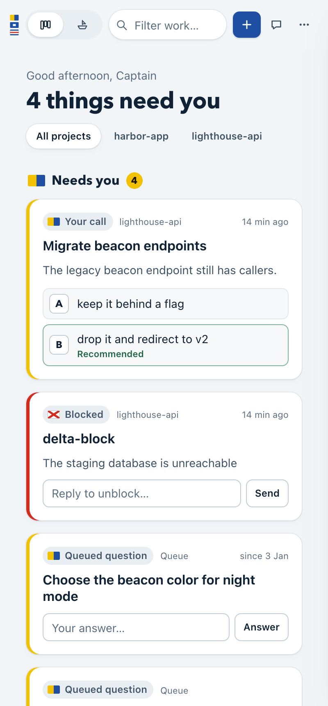

# Ship Deck

**One live board for your fleet of AI coding agents: see who needs you, answer
them, and talk to the agent running the fleet, all from your browser.**

## Why you'd want it

Running many AI coding workers at once quickly turns into terminal juggling.
Ship Deck fixes that:

- **No more tab-hopping.** Every worker is on one board instead of spread over
  a dozen terminal windows.
- **Know who needs you.** Workers waiting on a decision, blocked or failed rise
  to the top under **Needs you**; the rest sit in compact **Working**,
  **Waiting** and **Done** columns.
- **Answer without a terminal.** Pick a worker's option or type a reply right
  on its card. Merge, clean up or start new work with one click.
- **See what's happening.** A live peek at each worker's terminal and a feed of
  what the lead agent is doing right now.
- **Share what your agent knows (beta).** Invite teammates or friends by email
  and choose your skills, your notes, or both. Their agent picks them up
  automatically (Claude Code, Codex and Cursor), so you all work with the
  same context. They can also ask your notes questions or suggest an answer
  to one of your workers; you decide.
  [How to share](#share-with-your-team)

## What it does

- **Board**: what needs you first, as full cards you answer in place; the
  rest (working, waiting, done) as quiet compact cards with the title, latest
  update and pull request. Filter by project or search. Library, Settings,
  sharing, alerts and shortcuts live in one **More** menu.
- **Ship view**: the same fleet drawn as a nautical chart, one berth per worker
  flying its status flag.
- **Chat with the lead agent** (the "first mate"): a floating chat on every
  view; send messages and read its markdown replies.
  Paste, drop or attach screenshots and screen recordings; videos are turned
  into stills the agent can read.
- **One-click actions**: answer a decision, ask for status, merge a PR, clean
  up one or all finished workers, start a new job or a queued item. Each is a
  message the first mate acts on (and confirms anything irreversible); Ship
  Deck never does these itself.
- **Worker details**: the live terminal (last 80 lines, with colours), every
  status update, the brief and data files, a direct one-line message to the
  worker, and the command to resume its Claude Code session.
- **Per-worker model and effort**: switch a Claude worker's model or effort
  live from an allow-list; other tools get it on relaunch.
- **Library**: the first mate's context files, memory and skills, rendered as
  readable pages.
- **Activity feed**: what the first mate is doing and saying, live.
- **Team context sharing** (opt-in): grant a teammate by email and choose
  what to share: your skills, your notes and memory, or both. Their own Ship
  Deck pulls what you granted and installs it for their agent as read-only
  skills, automatically (Claude Code, plus Codex/`~/.agents` and Cursor). When you change a skill, the update reaches them;
  they cannot change your copy; secrets are scrubbed before anything leaves
  your machine; and every view and sync is logged. Revoke, or let the grant
  expire, and it is removed from their machine.
- **Know what's used and fresh**: see how often each teammate's agent used
  each shared skill; every item shows when it was last updated or verified,
  and old ones are flagged. Mark each note **Share** or **Private** (a
  Private note never leaves your computer).
- **Team pool**: offer a skill or note to the whole team; it reaches everyone
  once an approver accepts it.
- **Read-only board view** (opt-in): let a teammate watch your board in their
  browser. They can look, never send.
- **Comfort**: choose what the deck and the first mate call you ("Captain",
  "Boss", your first name or no title, in **Settings > You**); status is a
  signal flag, a colour and a word (readable without colour); light and dark
  themes that pass WCAG AA; keyboard shortcuts (press `?`); browser
  notifications on request.

## Screenshots




*(Screenshots use the fabricated sample fleet in `test/fixtures/home`.)*

## Quick start

You need **Node.js 18+** and **git**. Everything else is set up for you
(macOS/Linux, no sudo, safe to re-run).

**1. Install and start Ship Deck.** In one terminal, and leave it running:

```sh
git clone https://github.com/aryanbhandari047/ship-deck.git ~/ship-deck
sh ~/ship-deck/bin/install.sh
~/.local/bin/ship-deck
```

It opens http://127.0.0.1:4747/. In new terminals, plain `ship-deck` works.

**2. Start your first mate.** In a second terminal (first time only, sign in
to Claude Code when asked):

```sh
cd ~/firstmate && claude
```

**3. First time only, sign in to GitHub:**

```sh
gh auth login
```

The installer adds the tools your agents need (the Claude Code and GitHub
CLIs among them) when it can, or prints the one command to run. It sets up the
agent engine, [firstmate](#inspiration), at `~/firstmate`, copies the app to
`~/.ship-deck/app` and adds a `ship-deck` command that starts with sharing on
(nothing is sent until you sign in; see below). Add `--autostart` to start it
at login, `--no-share` to turn sharing off, or `--home DIR` to keep the engine
elsewhere.

Without the installer, run it straight from the clone: `npx .` or
`node server.js --home ~/firstmate`.

Try it on the sample fleet first, without touching a real one:

```sh
cp -R test/fixtures/home /tmp/ship-deck-sample
node server.js --home /tmp/ship-deck-sample --orders-dir /tmp/ship-deck-orders
```

- Full setup, including teaching your first mate to read the
  chat: [docs/TEAMMATE-SETUP.md](docs/TEAMMATE-SETUP.md)
- Flags, home detection, the message contract, sharing, security and more:
  [docs/REFERENCE.md](docs/REFERENCE.md)
- Letting other agents read a shared library: [docs/AGENT-LIBRARY.md](docs/AGENT-LIBRARY.md)

## Updating

**1. Get the new version.** In any terminal:

```sh
git -C ~/ship-deck pull && sh ~/ship-deck/bin/install.sh
```

The installer refreshes the copy in `~/.ship-deck/app` and keeps your sharing
choice (on, or off after `--no-share`).

**2. Restart Ship Deck.** In the terminal running it, press Ctrl-C, then:

```sh
ship-deck
```

If that terminal is closed, just run `ship-deck` in a new one.

**3. Restart your first mate** so newly shared skills load. In its terminal,
type `/exit`, then:

```sh
cd ~/firstmate && claude
```

Updating changes nothing else in the first mate's terminal.

## Share with your team

> **Beta:** sharing is new and may change. Tell us if something breaks.

Sharing goes through a small relay service you deploy once for your team
(steps in [`relay/README.md`](relay/README.md)). It is deployed by hand with
`vercel deploy --prod` from `relay/` and does not deploy on merge.

1. **Sign in** from **More > Share your deck** in the top bar. Sharing is on after
   install (`ship-deck` and `--autostart` connect to the Keychain relay), and
   nothing is sent until you sign in and add someone. To turn it off, and keep
   it off through updates:

   ```sh
   sh ~/ship-deck/bin/install.sh --no-share
   ```

   `--share` turns it back on, `--share-relay <relay URL>` uses your own
   relay, and `ship-deck --no-share` skips it for one run.
2. **Invite by email**: add a teammate and pick how long they get access
   (1, 7 or 30 days). New people get a one-time invite link to send them.
3. **Choose what to share.** Nothing is shared until you add someone; on a
   new grant only board, updates and model start ticked, the rest are off.
   All are read-only, except **suggest**, which only proposes:
   - **board**: worker titles, status, projects, ages and PR links.
   - **updates**: each worker's last few status lines.
   - **model**: each worker's model and effort.
   - **skills**: your skills, installed for their agent.
   - **terminal**: 40 scrubbed terminal lines per worker.
   - **notes**: your notes and memory, installed as one reference skill
     (Private notes never go).
   - **chat**: the first mate's chat and activity, labels only.
   - **ask**: their agent asks a question and gets up to 3 cited passages
     from your skills and notes; nothing is copied to their machine.
   - **suggest**: they propose an answer to a worker waiting on a decision.
     You see it on the card and send it yourself if you agree; their note is
     shown only to you and never sent.

   Skills and notes reach their agent automatically once their own Ship Deck
   is signed in (step 1). Settings > Sharing shows who viewed what, usage per
   shared skill, and the team pool.

The full walkthrough, from both sides: [docs/TEAMMATE-SETUP.md](docs/TEAMMATE-SETUP.md)
(steps 8 and 9) and the Sharing section of [docs/REFERENCE.md](docs/REFERENCE.md#sharing-read-only-opt-in).

## How it works

Ship Deck is a small Node server that runs on your own machine and is
reachable only from it. It reads your agents' status, queue, projects and
briefs without changing them, refreshing every 3 seconds, and shows each
worker's live terminal. Your chat messages and actions are handed to the lead
agent, which does the work and reports back on the board; the only things sent
straight to a worker are a one-line message or a model/effort change you make
yourself. There are no dependencies and no build step. Nothing leaves your
machine unless you turn on sharing. Exact files, commands and limits: [docs/REFERENCE.md](docs/REFERENCE.md).

## Inspiration

Ship Deck is built for and inspired by
[**firstmate**](https://github.com/kunchenguid/firstmate), the orchestration
layer it runs on: firstmate's first mate dispatches and supervises the coding
workers, and Ship Deck is the captain's view of that fleet.

## Tests

```sh
npm test
```
