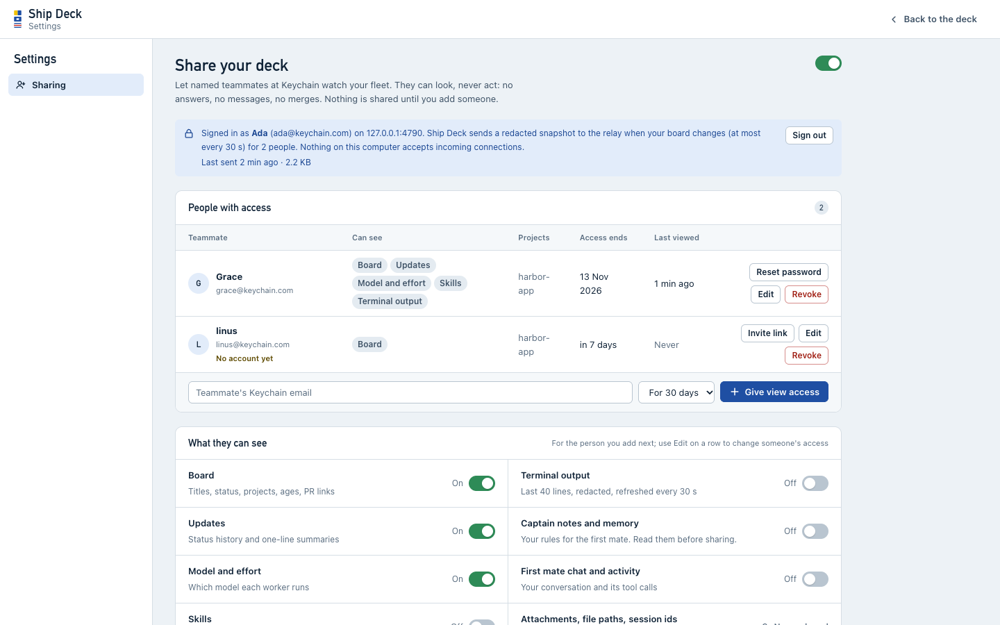
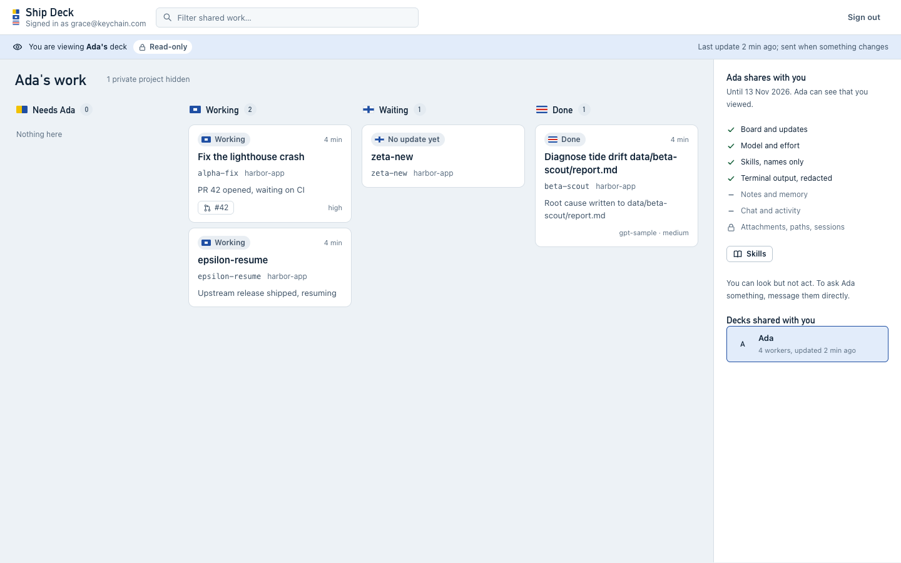

# Ship Deck reference

The details behind the [README](../README.md): where Ship Deck looks, every
flag, every screen, the message contract the first mate follows, attachments,
sharing, security, tests and the code layout.

## What is a firstmate home

The folder your firstmate runs in: `AGENTS.md`, `bin/` (with `fm-spawn.sh`
and `fm-send.sh`), `state/` (one record per worker) and `data/` (the queue,
projects, briefs and reports). Ship Deck only reads it, with one exception:
each new message appends one wake line to `state/ship-deck-inbox.status` so
the first mate notices it quickly (`--no-wake` turns that off).
`bin/install.sh` sets one up when none exists: it clones firstmate
(`FIRSTMATE_REPO` overrides the URL) into `~/firstmate` (or the `--home`
/ `FM_HOME` folder when that is missing or empty) and adds the git-ignored
`state/`, `data/` and `projects/` folders. An existing home is never changed,
and a non-empty folder that is not firstmate stops the install.

## Which firstmate home it reads

The first of these wins:

1. `--home /path/to/firstmate`
2. the `FM_HOME` environment variable
3. the current directory, if it looks like a firstmate home (it has
   `AGENTS.md`, `bin/fm-spawn.sh` and a `state/` folder)
4. `~/firstmate`, if it looks like a firstmate home

If none matches, the page shows a first-run screen listing where it looked,
pointing to `sh ~/ship-deck/bin/install.sh` to set one up, and how to point it
at an existing home. The Claude Code data for the home (the
first mate's transcripts and its memory folder) is found from the home path,
the same way Claude Code names its project folders
(`~/.claude/projects/<home path with / and . as ->/`), so nothing is
hard-coded to one machine.

The bridge shows your name instead of "Captain": `--captain-name "Your Name"`,
or else `git config user.name` as configured for the home (read from the git
config files; Ship Deck runs no git command).

## Command-line flags

```sh
ship-deck --home /path/to/home        # or FM_HOME=/path/to/home ship-deck
ship-deck --port 4800                 # first port to try, default 4747 (or SHIP_DECK_PORT)
ship-deck --no-open                   # don't open the browser (or SHIP_DECK_NO_OPEN=1)
ship-deck --captain-name "Your Name"  # name on the bridge (or SHIP_DECK_CAPTAIN)
ship-deck --no-tmux                   # skip the terminal liveness probe
ship-deck --stale-days 14             # "Quiet for N days" after this many days, default 7 (or SHIP_DECK_STALE_DAYS)
ship-deck --orders-dir DIR            # where messages are kept, default ~/.ship-deck (or SHIP_DECK_ORDERS_DIR)
ship-deck --memory-dir DIR            # first mate memory for the Ship's Library, default derived from the home
ship-deck --claude-dir DIR            # Claude Code data dir, default ~/.claude (transcripts, skills)
ship-deck --no-wake                   # don't append wake lines to <home>/state/ship-deck-inbox.status
ship-deck --share --share-relay https://<relay>   # opt in to read-only sharing (or SHIP_DECK_SHARE=1, SHIP_DECK_RELAY)
sh bin/start.sh [flags...]            # start in the background unless it already runs; prints the URL
```

`node server.js [flags]` is the same as `ship-deck [flags]`. The page polls
every 3 s and animates changes in place. If the server goes away it shows a
"reconnecting" banner and keeps retrying; drafts are kept in your browser.

Try it on the sample fleet without touching a real one:

```sh
cp -R test/fixtures/home /tmp/ship-deck-sample
ship-deck --home /tmp/ship-deck-sample --port 4748 --orders-dir /tmp/ship-deck-orders --captain-name "Sample Captain"
echo "done: sample finished" >> /tmp/ship-deck-sample/state/delta-block.status   # updates within ~3 s
```

## Start at login (macOS)

`bin/start.sh` checks whether Ship Deck already answers (on 4747 and the next
19 ports) first, so it is safe to run repeatedly; it logs to
`~/.ship-deck/server.log`. `sh bin/install.sh --autostart` installs this for you
(and a systemd user unit on Linux). To do it by hand,
replace the path with your clone, save it as
`~/Library/LaunchAgents/local.ship-deck.plist` and run
`launchctl load ~/Library/LaunchAgents/local.ship-deck.plist`:

```xml
<?xml version="1.0" encoding="UTF-8"?>
<!DOCTYPE plist PUBLIC "-//Apple//DTD PLIST 1.0//EN" "http://www.apple.com/DTDs/PropertyList-1.0.dtd">
<plist version="1.0">
<dict>
  <key>Label</key><string>local.ship-deck</string>
  <key>ProgramArguments</key>
  <array>
    <string>/bin/sh</string>
    <string>/path/to/ship-deck/bin/start.sh</string>
    <string>--no-open</string>
  </array>
  <key>EnvironmentVariables</key>
  <dict>
    <key>PATH</key><string>/opt/homebrew/bin:/usr/local/bin:/usr/bin:/bin</string>
    <key>FM_HOME</key><string>/path/to/firstmate</string>
  </dict>
  <key>RunAtLoad</key><true/>
</dict>
</plist>
```

## The views

- **Board** (default): four columns. **Needs you** (flag K): workers waiting
  on your call, blocked or failed, then queued questions; each card answers
  in place, with lettered option buttons or a one-line reply (the same
  messages and confirm step as the drawer). **Working** (P). **Waiting** (X):
  paused workers and workers with no update yet, then **Quiet for a while**
  (no activity for `--stale-days`, default 7; done workers are never quiet)
  and **Up next in the queue** with Start. **Done** (C): finished workers with
  Read report and Clean up, and "Clean up all" in the column head. Project
  chips filter the board; **New job** opens the job form. Second mates sit
  under the columns. Cards show the title first, then the id and project,
  the latest note, the pull request and the tool.
- **Ship**: the same fleet as a nautical chart. The bridge shows you (Ashore
  when `state/.afk` exists), the first mate with what it is doing, and the
  monitoring lamp. One zone per project with a flag tally (the legend says
  what each flag means), one berth per worker flying its flag, second mates as
  portholes and the queue as crates in the hold. A flag is hoisted once when a
  worker starts needing you; nothing loops.
- **Board or Ship** is remembered per browser (`localStorage`).
- **Side panel**: the first mate's head line (click for its drawer: monitoring,
  its own session and every past worker session), then **Chat** (newest at the
  bottom, day separators, receipts under your messages: Sent, not seen yet /
  Seen / Answered; action messages as cards with Sent, Seen, Done steps; an
  unread badge; suggested messages; "Enable alerts" for browser notifications,
  only requested from that button) and **Activity**
  ([First mate activity](#first-mate-activity)). Drag the handle on its left
  edge (or focus it and use the arrow keys, Shift for bigger steps, Home/End
  for min/max, Enter or double-click to reset to 420 px); 320 px to 70% of the
  window, remembered. Below 900 px the panel stacks under the view and a chat
  button in the header jumps to it.
- **Worker drawer**: click a card or berth; `#task=<id>` deep-links. The
  status and last update, the title, id, project, pull request and tool, then
  Ask for status, Merge PR, **Open in terminal** (the resume command) and
  Clean up. A worker that needs you shows its question and answer box on top.
  Tabs: **Terminal** (the latest update, the live terminal with Wrap, Follow,
  Pause and Copy, and Message the worker), **Updates** (every status line,
  one timestamp format), **Details** (brief, data files, facts in words,
  messages about it) and **Model and effort**.
- **Queue item drawer**: its question and answer box (queued questions), or
  Start this, its details in words and its notes.
- **Ship's Library** (book button): the first mate's permanent context files,
  memory and skills, by title, rendered as safe markdown.
- **Keyboard** (press `?` for the sheet, with the flag legend): `/` or Cmd/Ctrl+K
  filters; `G` then `B`/`S`/`C`/`A`/`L` goes to the Board, Ship, Chat,
  Activity or Library; `J`/`K` move between cards, `←`/`→` between columns,
  `Enter` opens, `N` jumps to the next thing that needs you, `A`-`H` picks an
  option on the selected card; in a worker `1`-`4` switch tabs, `W` wraps,
  `F` follows, `O` opens the pull request, `M` messages the worker; `Esc`
  closes or goes back. In the chat Enter sends, Shift+Enter adds a line,
  Cmd+V pastes a screenshot.

Follows the OS light/dark theme and respects reduced motion (every
animation and transition off).

## Words on screen

Ship Deck speaks plain language; the files and the API keep firstmate's own
names, so nothing changes for the first mate:

| On screen | In firstmate / the API |
| --- | --- |
| Message | order (`orders.jsonl`, `POST /api/orders`) |
| Chat | the Bridge: your messages and the first mate's replies (`replies.jsonl`) |
| Worker | crew member / task (`state/<id>.meta`) |
| Job (New job) | a new task (`new-task` order) |
| Task title, with the id beside it | the queue entry title, else the brief's first line, else the id |
| Card summary | the last status line, without its lettered options (in full under Updates in the drawer) |
| Your call / Needs you | needs-decision / blocked / failed workers and Captain's Call queue items |
| Queued question | a Captain's Call queue item |
| Queue, Up next in the queue | backlog (`data/backlog.md`) |
| Second mates | secondmates (`data/secondmates.md`) |
| Past sessions, Open in terminal | the recorded Claude Code sessions (`~/.ship-deck/sessions.json`) |
| Quiet for N days | stale (no activity for `--stale-days`) |
| Tool | harness (claude, codex, ...) |
| Workspace (details only) | worktree |
| Monitoring | the watcher heartbeat (`state/.last-watcher-beat`) |
| Terminal | the worker's tmux window |

Message kinds read as: Message (`chat`), Your decision (`decision`,
`backlog-answer`), Status check, Merge pull request, Clean up worker, Clean up
finished workers (`cleanup-done`), New task (`new-task`), Start from queue
(`backlog-start`), Settings change (`config`). The mapping lives in
`public/labels.js`.

The header's health strip reads: **First mate listening** (its transcript
moved in the last 2 minutes, or a tool call is in progress), **Monitoring on**
(watcher heartbeat under 2 minutes; "late" otherwise) and the last update
time; **Deck offline** appears only when the page cannot reach the server.
Queue tags show in words (Project, Waiting since, Starts after); parser
bookkeeping (`kind`, `hold-kind`) stays hidden, and no screen prints an
absolute path (folders show with your home as `~`).

## Status flags

Every status is an International Code of Signals flag (inline SVG), a colour
and a word, chosen for its meaning at sea (`public/board.js`):

| Flag | Meaning at sea | On screen | firstmate state |
| --- | --- | --- | --- |
| K | I wish to communicate with you | Needs you ("Your call") | needs-decision |
| V | I require assistance | Blocked | blocked |
| P (Blue Peter) | Under way | Working | working, resolved |
| X | Watch for my signals | Waiting ("Paused", "No update yet") | paused, no status yet |
| C | Affirmative | Done ("Report ready" for a scout with a report) | done |
| O | Man overboard | Failed | failed |
| Struck (dashed) | | Quiet for N days | stale, whatever the state |

The palette ("Chart room": chart-water canvas, white surfaces, deep-water ink,
signal blue for actions, signal yellow only for "needs you"; a navy night watch
in dark mode) passes WCAG AA for every text pair in both themes,
checked by `test/contrast.test.js` against the tokens in `public/style.css`.

## What you can do

- **Chat**: free-text messages to the first mate; its replies (via
  `bin/orders.js reply`) render in the same thread (safe markdown, PR links
  open in a new tab). Paste, drop or attach screenshots and screen recordings
  ([Attachments](#attachments)).
- **Ask the first mate**: answer a worker's question (on its card or in its
  drawer), check status, merge, clean up, start a New job, start something
  from the queue, clean up all finished workers, change settings. Each is a message the first mate acts on;
  Ship Deck never does these itself.
- **Terminal peek**: a worker's details show the last 80 lines of its
  terminal (`tmux capture-pane -p -e -J -t <window> -S -80`), refreshed every 2 s,
  with its colours (parsed into class names, never HTML) and Wrap/Follow toggles.
- **Message a worker directly**: one line (max 2000 chars, confirmed first)
  sent with exactly `FM_HOME=<home> <home>/bin/fm-send.sh <window> <message>`.
- **Live settings** (claude workers only): `/effort <level>` or
  `/model <model>` through the same fm-send call, from an allow-list.

Those fm-send calls (plus `tmux capture-pane` and `tmux list-windows`) are the
only commands it runs while serving, always via `execFile` with a fixed argv;
at startup it may also run the platform's browser opener (`open`,
`xdg-open` or `start`) with its own URL (`--no-open` skips it). The page only
sends worker ids, library keys and allow-listed values; the terminal target
always comes from `state/<id>.meta`. The only files it writes are in
`~/.ship-deck/` (dir 0700, files 0600), attachments included, plus the wake
line above. It reads `~/.claude/` (transcripts, skills, memory) but never
writes there.

## Messages and the Bridge: the first mate's contract

On screen these are *messages*; in the files and the API they keep their
original name, *orders*.

Three append-only JSON-lines logs in `~/.ship-deck/` (or `$SHIP_DECK_ORDERS_DIR`):

| File | Written by | Line |
| --- | --- | --- |
| `orders.jsonl` | Ship Deck | `{id, ts, kind, target, text, status:"pending", ...payload}` |
| `orders-ack.jsonl` | first mate (`ack`) | `{id, ts, status, note}`, status `acknowledged`, `done` or `declined` |
| `replies.jsonl` | first mate (`reply`) | `{id, ts, kind:"reply", inReplyTo, text, attachments?}` |

Order ids look like `o-20261012T160000123Z-ab12` and reply ids `r-...`; both
sort by time. An order's lifecycle is its acks: pending (no ack) ->
acknowledged -> done or declined; the UI shows every step with its note.
`target` is a crew id (or `null`), `text` is what the captain wrote or a default.
`sessions.json` (resume ids, below) lives in the same directory.

Fast lane: every new order (any kind) also appends exactly one line to
`<FM_HOME>/state/ship-deck-inbox.status`, so the first mate's status monitor
wakes within one poll instead of waiting for the slow `orders.jsonl` check:
`message: <order-id> <kind> <first 80 chars of text, whitespace collapsed>`.
The file is append-only (O_APPEND, 0644 if created, never truncated, renamed or
deleted); a failed write is logged and the order still queues. It is only a
wake signal: `orders.jsonl` stays the source of truth and `bin/orders-check.sh`
the backstop. `--no-wake` turns it off.

| kind | target | payload | meaning |
| --- | --- | --- | --- |
| `chat` | - | `text` (multi-line, max 4000; may be empty when there are attachments), optional `attachments` | Free-text message from the Bridge. Answer with `reply`. |
| `decision` | crew id | `option` (`A`-`H` or `null`), `text` | Answer to a needs-decision/blocked worker; `text` is `(B) <option text>` plus any note, or a free answer. |
| `answer` | crew id | `text` | Legacy free-text answer (older UI). |
| `status` | crew id | - | Ask the worker for a status update. |
| `merge` | crew id | - | Merge its PR. Irreversible: confirm with the captain first. |
| `cleanup` | crew id | - | Tear the worker down. Irreversible: confirm first. |
| `cleanup-done` | - | `targets`: crew ids that were done when queued | Clean up all finished workers. Irreversible: confirm first. |
| `new-task` | - | `project` (from `data/projects.md`), `taskKind` (`ship` or `scout`), optional `harness`, `model` (absent = first mate default), `effort` (`auto` = first mate decides), `text` | Dispatch a new task. |
| `backlog-start` | - | `item` (backlog id), `text` | Start this queued backlog item. |
| `backlog-answer` | - | `item` (backlog id), `option`, `text` | The captain's answer to a Captain's Call item. |
| `config` | crew id | `field` (`effort` or `model`), `value`, `applied` | Record of a config change. `applied:true` = already sent live (`/effort`/`/model` via fm-send; takes effect from the worker's next turn); `applied:false` = apply it when relaunching the worker. Only created by `POST /api/config`. |
| `order` | optional | `text` | Legacy free-text order. |

The UI asks for confirmation before every order; for `merge`, `cleanup` and
`cleanup-done` it says plainly that the first mate will still confirm before
acting.

```sh
node bin/orders.js list [--pending] [--json]       # pending = no ack yet; payload shown under each order
node bin/orders.js ack <id> <acknowledged|done|declined> [note...]
node bin/orders.js reply <order-id> [--ack done] "text"   # reply in the Bridge (optionally ack too)
node bin/orders.js reply - "text"                  # unprompted message from the first mate
node bin/orders.js reply <order-id|-> --file report.md    # long markdown (--file - reads stdin)
node bin/orders.js reply <order-id|-> --attach shot.png [--attach demo.mp4] "text"   # with images/videos
node bin/orders.js thread [--limit 30] [--json]    # the conversation as the captain sees it
node bin/orders.js sessions [--json]               # recorded resume commands
sh bin/orders-check.sh    # prints "ship-deck: N new captain order(s)" or nothing
```

Replies are markdown (max 64 KB): paragraphs, lists, **bold**, `code`, fenced
code, tables and links. Ship Deck escapes all HTML and only links `http(s)`
URLs (bare PR URLs autolink and open in a new tab). New replies raise an unread
badge and, if the captain enabled alerts, a browser notification; so do new
"needs the captain" items.

`bin/orders-check.sh` is self-contained POSIX sh + awk, meant to be copied into
firstmate's watcher as a custom wake check. It counts every new order of any
kind, chat included (replies never wake it), and remembers the newest order id
it has reported in `~/.ship-deck/orders-check.cursor`. All three scripts honour
`SHIP_DECK_ORDERS_DIR`.

## Attachments

The Bridge composer takes images and videos three ways: paste (Cmd+V of a
screenshot), drag and drop onto the Bridge, or the paperclip button. Each one
shows as a thumbnail with a remove (×) button; up to 10 per message. A message
may be attachments only.

| kind | accepted (by magic bytes, server-side) | max each |
| --- | --- | --- |
| image | png, jpeg, gif, webp | 20 MB |
| video | mp4, mov (QuickTime), webm | 200 MB |

Anything else (pdf, svg, mkv, a text file renamed `.png`...) is refused with a
clear message. The client's MIME type and file name are never trusted: the
stored name gets the extension of the sniffed type.

**Protocol.** Each file is uploaded as soon as it is added:

1. `POST /api/attachments?name=<file name>` with the raw file as the body
   (`X-Ship-Deck: 1`, any non-form `Content-Type`, from 127.0.0.1 only) ->
   `{ok, attachment: {id, kind, name, mime, size}}`. `id` is a UUID.
2. For a video, the browser draws stills with `<video>` + `<canvas>` (one
   every 2 s, at most 40 spread over the whole video, JPEG up to 1280 px wide)
   and uploads each as `POST /api/attachments?parent=<id>&name=frame-0001.jpg`,
   then `name=index.json` (`{duration, width, height, frames: [{file, t}]}`;
   the server rewrites it from known fields and adds the video path). The
   chip shows "extracting frames N/M" and Send stays disabled until it ends.
   Claude can read images but not video, so the stills are what the first mate
   looks at. If the browser cannot decode the video, it is sent without
   stills and the chip says so.
3. `POST /api/orders {kind:"chat", text, attachments:[id, ...]}`: the server
   checks every id and records `attachments: [{id, kind, name, path, size,
   mime}]` on the order, where `path` is the absolute local file the first mate
   reads; videos also carry `frames` (the stills dir, or `null`) and
   `frameCount`.

**Where files live:** `~/.ship-deck/attachments/<uuid>/<safe-name>` (plus
`.meta.json`, and `frames/frame-NNNN.jpg` + `frames/index.json` for videos);
dirs 0700, files 0600. `node bin/orders.js list --pending` prints each path
(and the frames dir) under the message. Uploads removed before sending stay on
disk until deleted by hand; any `attachments/<uuid>` dir no order or reply
names is safe to delete.

**Viewing:** the thread shows images as thumbnails (click to enlarge, Esc
closes) and videos as inline players, served by `GET /api/attachments/<id>`
with `Range` support (206/416). It only serves the regular file recorded in
that attachment's `.meta.json`, addressed by UUID; symlinks and any other path
are refused. Responses carry `nosniff` and a sandbox CSP.

**First mate replies:** `reply --attach <path>` (repeatable) checks each file
the same way before writing anything, copies it into the attachments dir and
renders it in the thread (videos from replies get no stills).

## Per-worker configuration

Each worker's details show its tool (harness), model and effort under Settings: the values in
`state/<id>.meta`, overridden by the latest applied `config` order (unapplied
ones show as "on relaunch"). Each picker starts on "Current (<value>)" and
Apply stays off until a different value is picked. The pickers are
allow-listed server-side (`lib/config.js`); anything else is rejected:

| harness | effort | model | live |
| --- | --- | --- | --- |
| claude | `low` `medium` `high` `xhigh` `max` | `claude-opus-5-5` `claude-sonnet-5` `claude-haiku-4-5-20251001` `claude-fable-5-1` | yes |
| codex | `low` `medium` `high` `xhigh` | current only | no |
| grok | `low` `medium` `high` | current only | no |
| pi, opencode | current only | current only | no |

`POST /api/config {id, field, value}`: for a claude worker with a window the
server runs `fm-send.sh <window> "/effort <value>"` (or `/model`) and records a
`config` order with `applied:true`; otherwise it only queues the order with
`applied:false`. The New task form carries harness/model/effort in `new-task`.

## Resumable sessions

Claude Code keeps transcripts in `~/.claude/projects/<encoded-cwd>/<uuid>.jsonl`
(cwd with `/` and `.` replaced by `-`). For each claude crew member Ship Deck
lists the transcripts in its worktree, verifies the first lines' `cwd` and
`sessionId`, and, because worktrees are reused, gives each transcript one owner:
the crew member whose brief it names (`state/<id>.status`), else the task
spawned (meta birth time) most recently before the session started. The first
mate is the newest verified session in FM_HOME. Matches are merged into
`~/.ship-deck/sessions.json` (0600) as `{id: {sessionId, cwd, harness,
firstSeen, lastSeen}}` (the first mate under `_firstmate`) and kept after the
crew member leaves. A worker's **Open in terminal** and the first mate drawer's
**Past sessions** show the folder (home as `~`) and `claude --resume
<sessionId>`; Copy copies the full `cd '<cwd>' && claude --resume <sessionId>`.
Other harnesses show "Resume id unknown (<harness>)".

## First mate activity

The side panel's **Activity** tab answers "what is the first mate doing right now". It
reads, and never writes, the first mate's own Claude Code transcript: the
newest verified `~/.claude/projects/<encoded FM_HOME>/<uuid>.jsonl` (the same
discovery the past sessions use, rechecked every 5 s, so a new first mate
session takes over the feed with a "New first mate session" marker). The
server (`lib/activity.js`) tails it incrementally: it remembers a byte offset,
starts at most 1 MB from the end on a first look, leaves a half-written last
line for the next poll, and starts over if the file shrinks. Sidechain lines
are skipped.

Each assistant `tool_use` becomes one event; its `tool_result` marks it done or
failed (`is_error`) with the duration. Short text replies (first 140 chars)
appear inline. Summaries:

| tool | shown as |
| --- | --- |
| `Bash` | its `description`; click to expand the command (inline credentials masked) |
| `mcp__claude-in-chrome__*` | `Browser: navigate <url>`, `Browser: find "<query>"`, `Browser: click/screenshot/key…`; `type` shows `Browser: typing…`, never the text |
| `Read` / `Edit` / `Write` | `Reading/Editing/Writing <basename>` |
| `Agent` / `Task` | `Delegated: <description>` |
| `Artifact` | `Publishing <title or file name>` |
| anything else | the tool name only |

Input fields whose name looks like a password, token, secret, key, cookie,
authorization, credential or session are dropped before any summary is built.
`GET /api/activity?since=<rev>&epoch=<epoch>` returns only events changed since
the previous response (`full:true` with everything when the cursor is unknown);
the page asks after every fleet poll and keeps the last 200 events. The panel
head (and the first mate on the Ship view's bridge) reads **Working: <latest
event>** or **Idle, last active …** (working = a tool call without its result,
under 10 min old, or a transcript line in the last 20 s), and the chat shows
"First mate is …" under the newest message while it works.

## Sharing (read-only, opt-in)

Off unless Ship Deck starts with `--share --share-relay https://<relay>`. Then the share
button in the top bar opens **Settings > Sharing** (`/share.html`):

1. Sign in with your relay account (invite-only, limited to the relay's email domain, `ALLOWED_HD`). The password goes
   straight to the relay; Ship Deck keeps only a revocable device token in
   `~/.ship-deck/share.json` (0600).
2. Add a teammate by their email (same domain), pick what they can see and which projects,
   for 1, 7 or 30 days. New people get a one-time invite link (24 h) that you send them
   yourself; the same button on an existing account is the password reset.
3. They open the relay's page and see your Board read-only. "Who viewed what" lists every view
   and refusal (kept 90 days by the relay). Revoke takes effect on their next request.
4. If you share **Skills** or **Captain notes and memory**, a teammate whose own Ship Deck is
   signed in to the relay gets them automatically: every 10 minutes their deck checks a hash
   and writes changed knowledge into their `~/.claude/skills` as read-only
   `teammate-<your-name>-<skill>` skills (notes and memory as one `teammate-<your-name>-notes`
   skill), each starting with a "Shared by … via Ship Deck" header. "Use knowledge shared with
   me" in their Settings > Sharing (on by default) turns it off; turning it off, signing out,
   or your grant being narrowed, revoked or ending removes them. Only directories with Ship
   Deck's marker file are ever written or removed (`lib/knowledge.js`,
   [`docs/AGENT-LIBRARY.md`](AGENT-LIBRARY.md)).




What leaves the computer is an allow-list built in `lib/share.js` (field by field, see
`WORKER_KEYS`), scrubbed by `lib/redact.js`: tokens (GitHub, Slack, AWS, OpenAI/Anthropic,
Stripe, Google, JWTs, PEM blocks, `Authorization`/`Bearer`, `password=`/`token=`/`secret=`
values, any 32+ character high-entropy run), the home path shown as `~`, other absolute
paths as "path hidden", URL queries and fragments dropped and links kept only for
github.com and linear.app. Caps: 200 characters per summary, 40 terminal lines (ANSI
stripped), 64 KB per snapshot. Workers are keyed by an HMAC of their id.

| Shared | Default | |
|---|---|---|
| Board (titles, status, projects, ages, PR links) | on | |
| Updates (last 5 status lines) | on | |
| Model and effort | on | |
| Skills (full text, redacted: the teammate's own Ship Deck gives them to their agent) | off | see [`docs/AGENT-LIBRARY.md`](AGENT-LIBRARY.md) |
| Terminal (40 redacted lines, every 30 s) | off | |
| Captain notes and memory (also given to their agent as one reference skill) | off | |
| First mate chat and activity (labels only) | off | |
| Attachments, paths, worktrees, windows, session ids, orders | never | not in the allow-list |
| Sending anything | never | viewers can only make and revoke their own agent keys; `/v1/knowledge` and `/v1/agent` are GET only |

Nothing is pushed until someone has an active grant. The share agent pushes only when the
redacted snapshot changes, at most every 30 s, plus a keep-alive every 10 minutes; on quota,
rate-limit or network errors it backs off (30 s doubling to 15 min) and Settings shows
"Sharing paused". Nothing listens for the relay: everything it returns is shown as data,
and `lib/share.js` cannot reach orders or fm-send (a test checks its imports). The relay
itself (Vercel + Upstash free tiers, deploy steps, cost estimate) is in
[`relay/README.md`](../relay/README.md).

## Security

- Binds `127.0.0.1` only; every request must carry `Host: 127.0.0.1:<port>` or
  `localhost:<port>` (blocks DNS rebinding).
- `POST /api/send`, `POST /api/orders` and `POST /api/config` also require `X-Ship-Deck: 1`,
  `Content-Type: application/json`, a same-origin `Origin` when one is sent, and
  no cross-site `Sec-Fetch-Site`. Bodies are capped at 16 KB.
- `POST /api/attachments` has the same header, Origin and Sec-Fetch-Site checks,
  refuses form content types and non-loopback peers, and streams the raw body
  to disk with the per-type cap applied as bytes arrive. Attachment ids must be
  UUIDs; frame names must be `frame-NNNN.jpg` or `index.json`.
- Action ids must match `^[a-z0-9][a-z0-9-]*$` and have a `state/<id>.meta`;
  the window recorded there must look like `session:window`.
- File views only serve regular files directly under `data/<id>/` (symlinks out
  are refused). The Ship's Library serves only a server-side allow-list (see
  below), addressed by key, never by path.
- Sharing (`--share`, off by default) only makes outbound HTTPS requests to the configured
  relay (http only for localhost). `POST /api/share/*` has the same `X-Ship-Deck`, Origin and
  Sec-Fetch-Site checks. The sign-in password is passed to the relay once and never stored.
- Order payloads are validated against the live home: crew ids need a meta,
  `cleanup-done` targets must be done, projects come from `data/projects.md`,
  backlog items must exist, config values come from the allow-list.

## Tests

```sh
npm test            # same as: node --test test/*.test.js relay/test/*.test.js
```

`test/share.test.js` covers the share projection (no home, worktree, window, session, files,
orders, thread or attachments whatever the toggles), redaction of known secret shapes, the
caps, HMAC refs, grant unions, the agent's push pacing and back-off, and that the relay's
allow-list and UI copies match the deck. `test/share-e2e.test.js` runs a real deck with
`--share` against the relay dev server: sign-in, grant, push, a granted viewer, a refused one
and the audit. It also covers the knowledge library projection (skills and notes per scope,
redacted, capped) and its push and removal. `test/knowledge.test.js` covers the other side:
two real decks and the relay, granted skills and notes landing in the teammate's skills dir
(header, redaction, namespaced and collision-safe names, read-only), and removal on toggle
off, narrowed, revoked or expired grants and sign-out, touching only marked directories. `relay/test/` covers auth (domain, invites, scrypt, lockout, sessions, no
password leaks) and the relay routes (grant checks, append-only audit, no viewer write route,
Redis commands per request), knowledge sync (`relay/test/knowledge.test.js`) and agent keys (`relay/test/agent.test.js`: scopes off,
revoked or expired keys, notes gating, one audit row per read, the hourly limit, GET only).

`test/actions.test.js` covers the orders queue, CLI and wake check (temp
`HOME`), window lookup, peek/send with an injected executor (fm-send is never
run), data-file and library allow-lists, and the CSRF/Host guards.
`test/bridge.test.js` covers replies and the thread, every order kind, the
wake check on chat orders, decision option parsing, Captain's Call against the
real backlog format (`test/fixtures/backlog/real-format.md`), session discovery
and `sessions.json`, skills, the markdown renderer, the config allow-list and
the exact fm-send argv, and `bin/start.sh`.
`test/peek.test.js` covers the terminal peek's SGR parser (`public/ansi.js`:
colour classes, unclosed codes, malicious and truncated sequences) and the
settings picker preselecting the current value.
`test/attachments.test.js` covers magic-byte validation, safe names and path
traversal (ids, frame names, tampered metadata, symlinks), size limits, the
upload guards, Range serving, video stills, chat orders with attachments,
`reply --attach` and the `list` output, with fabricated bytes only.
`test/activity.test.js` covers the activity feed against a fabricated
transcript (`test/fixtures/transcript/firstmate.jsonl`): tool summaries,
redaction, a partial last line, `is_error` results and durations, rotation to
a newer session, the 200-event cap, tail-only reads, the read-only fingerprint
and `GET /api/activity`.
`test/parsers.test.js` covers the parsers against the fabricated fixtures
(including prose in parentheses not being read as a queue tag).
`test/board.test.js` covers the status flag mapping (every state to its tone,
flag and word) and the Board grouping on the fixture fleet: columns, sort
order, quiet workers, queued questions and next items, project and search
filters, and the card summary.
`test/contrast.test.js` checks every text colour pair the UI uses for WCAG AA
(4.5:1) in the light and dark tokens of `public/style.css`.
`test/snapshot.test.js` builds a snapshot from a temp copy of the fixture home,
checks missing files and an empty home, proves no file under the home changes
(size + mtime fingerprint), and runs the HTTP server to confirm a `.status`
append shows up in the next `/api/fleet` response.
`test/portable.test.js` covers home auto-detection against fixture homes
(`--home`, `FM_HOME`, the current directory, `~/firstmate`, none), the memory
dir derived from the home, the captain's name from git config files, task
titles, the plain-language labels and summaries, port fallback, the
first-run server and `bin/start.sh` falling back to a free port.
`test/install.test.js` runs `bin/install.sh` in a temp `HOME` with a fixture
firstmate home and shimmed `launchctl`/`systemctl`/`curl`/`brew`/`uname` (no
network): the app copy and launcher, idempotent re-runs, setting up firstmate
from a local `FIRSTMATE_REPO` (and leaving an existing home alone), refusing a
foreign folder, installing missing tools, `--home`, `--edit-path`, and that
nothing outside `~/.ship-deck` and `~/.local/bin` is written without
`--autostart`.

## What it reads

All paths are relative to the fleet home. Missing files are fine.

| Source | Used for |
| --- | --- |
| `state/<id>.meta` | One crew member per file: `project`, `kind` (ship/scout/secondmate), `mode`, `harness`, `model`, `effort`, `window`, `worktree`, `pr`, `pr_head` |
| `state/<id>.status` | Last line is the displayed state (`resolved` shows as working); the last 5 lines feed the detail drawer. An optional `YYYY-MM-DD HH:MM` prefix and `[key=...]` are parsed; stray non-status lines are skipped. Only the last 64 KB is read. |
| `state/<id>.turn-ended` and file mtimes | "Last activity" and "turn ended" times |
| `state/.afk` | Present means the captain is ashore (shown on the Ship view's bridge) |
| `state/.last-watcher-beat` mtime | Monitoring lamp and health strip: green under 2 min, amber ("late") otherwise |
| `data/backlog.md` | Loose parse of Captain's Call / In flight / Queued / Done; unknown sections are tolerated. Queued items become "Up next in the queue" rows (and crates in the Ship view's hold). Captain's Call = every open item in the Captain's Call section or tagged `(kind: captain)` / `(hold-kind: captain)` in any open section (the real file keeps them in Queued); options in its `(hold: ...)` become answer buttons. |
| `data/projects.md` | Project names (Board filter chips, Ship view zones), delivery modes and descriptions |
| `data/secondmates.md` | Second mates (registry entries without a live meta show as not running) |
| `data/<id>/brief.md` | The task title when the queue has no entry for the id (a leading `# Title`, else the first line under `# Task`), and the first paragraph under `# Task` as the summary in the details |
| `data/<id>/report.md` | Existence makes a done scout "Report ready" with a Read report link (served as plain text by `/api/report/<id>`) |
| `data/<id>/*` | Listed in the drawer; click opens a read-only text view (`/api/file/<id>/<name>`) |
| `<home>/.git/config`, `~/.gitconfig`, `~/.config/git/config` | `user.name` for the captain's name on the bridge (unless `--captain-name`) |
| Ship's Library | `AGENTS.md`, `data/captain.md`, `data/captain-shared.md`, `data/learnings.md`, `data/projects.md`, `data/secondmates.md`, `data/backlog.md`, every `*.md` in the first mate's memory dir (`~/.claude/projects/<encoded home>/memory`, or `--memory-dir`; MEMORY.md first), and the skills, each with a plain title (Captain's preferences, Memory index) and its short location; files not written yet say so |
| `state/<id>.status` last line (needs-decision/blocked) | Lettered options `(A) ...`, `(B, recommended) ...`, `Options: A) ...`, `option A, ...` become decision buttons |
| `~/.claude/projects/*/<uuid>.jsonl` (head only) | Session discovery for resume commands |
| `~/.claude/projects/<encoded FM_HOME>/<uuid>.jsonl` (tail, newest session) | The first mate activity feed |
| `~/.claude/skills/*/SKILL.md`, `<home>/.agents/skills/*/SKILL.md` | Skills in the Ship's Library (name and description from the frontmatter); `teammate-*` skills synced from a teammate (with `--share`) are grouped as "Shared by <name>" and never shared on |
| `tmux list-windows -a` | Optional: marks whether a crew member's window is open. Skipped if tmux is missing. |

## Layout

```
server.js          HTTP server: static files, /api/*, POST guards, port fallback, startup
lib/home.js        Firstmate home detection, Claude dirs for a home, captain name
lib/fleet.js       Parsers and the read-only snapshot builder
lib/actions.js     Window lookup, pane peek, fm-send, data files (the only exec)
lib/orders.js      Orders queue in ~/.ship-deck
lib/attachments.js Bridge attachments: magic bytes, storage, stills, Range serving
lib/library.js     Ship's Library allow-list (home files, memory, skills)
lib/share.js       Sharing (--share): redacted snapshot and knowledge pushes, knowledge sync
lib/knowledge.js   Teammates' shared knowledge as marked teammate-* skills (the only ~/.claude writer)
lib/sessions.js    Claude session discovery and ~/.ship-deck/sessions.json
lib/activity.js    First mate activity feed: read-only transcript tail
lib/config.js      Per-harness model/effort allow-list and slash commands
bin/orders.js      Orders, replies, thread and sessions CLI for the first mate
bin/orders-check.sh  Watcher wake check (POSIX sh)
bin/ship-deck.js   `ship-deck` / `npx` entry (same flags as server.js)
bin/start.sh       Start the server in the background unless it already answers
bin/install.sh     Per-person install: prerequisites, firstmate home, ~/.ship-deck/app, launcher, opt-in autostart
docs/TEAMMATE-SETUP.md  Step-by-step setup guide
docs/REFERENCE.md  This reference
public/            index.html, style.css, app.js, board.js (flags + Board grouping), markdown.js, labels.js, ansi.js (no build step)
test/              node:test suites and fabricated fixtures
```
