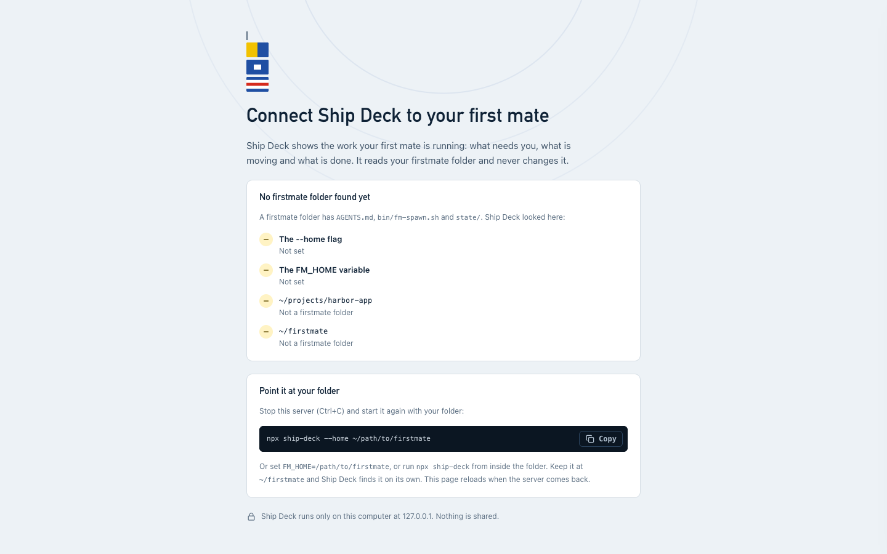

# Ship Deck for Keychain teammates

Ship Deck is a window onto your own firstmate: a board of what your workers
are doing, a chat with your first mate, and buttons for the usual answers.
Everything runs on your laptop. There is nothing to host, no server to share
and no one else's fleet to reach: your Ship Deck talks only to your first mate,
at `http://127.0.0.1:4747/`, the same way the captain's does.

Setup takes about 15 minutes, most of it firstmate itself.

## What you will see (60 seconds)

**The Board.** Every worker in one of four columns: **Needs you**, **Working**,
**Waiting** and **Done**. Each card has the task title, a status flag and the
latest update. Answer a worker's question right on its card. The chat with your
first mate sits on the right.


**A worker that needs you.** Click a card for its details: the question on top,
the answer buttons, and a live view of the worker's terminal.


**Attachments.** Paste a screenshot or drop a screen recording into the chat;
your first mate gets the image (and stills from the video).


**Activity.** What your first mate is doing right now, live from its own
session.


**The Ship view** shows the same fleet as a chart, if you like that better.
Press `?` any time for keyboard shortcuts. It follows your Mac's dark mode.


*(Screenshots use made-up sample data.)*

## 1. Before you start

You need, on your laptop:

- **Claude Code**, installed and signed in: run `claude` once and finish the
  sign-in.
- **GitHub CLI**, signed in: `gh auth login` (firstmate opens pull requests
  with it).
- **tmux**: `brew install tmux` on a Mac, `sudo apt install tmux` on Ubuntu.
- **Node.js 18 or newer** (`node --version`) and **git**.

## 2. Install firstmate

firstmate is the open-source first mate that Ship Deck shows. Put it at
`~/firstmate` and Ship Deck finds it on its own:

```sh
git clone https://github.com/kunchenguid/firstmate ~/firstmate
```

Then follow its README to start your first mate once in a terminal. If you
keep it somewhere else, that is fine: pass `--home /that/folder` when you
install Ship Deck below.

## 3. Install Ship Deck (one command)

The Ship Deck repo is private: you'll need to be added as a collaborator
first; ask Aryan. Once you have access:

```sh
git clone https://github.com/aryanbhandari047/ship-deck.git ~/ship-deck && sh ~/ship-deck/bin/install.sh
```

The installer checks the tools above, tells you if firstmate is missing (with
the exact command to get it), copies Ship Deck to `~/.ship-deck/app` and adds a
`ship-deck` command in `~/.local/bin`. It never uses `sudo` and changes nothing
outside those folders unless you ask:

| Add this | To |
| --- | --- |
| `--home /path/to/firstmate` | use a firstmate folder that is not `~/firstmate` |
| `--edit-path` | add `~/.local/bin` to your PATH in your shell settings (otherwise it prints the line for you to add) |
| `--autostart` | start Ship Deck at login (a LaunchAgent on a Mac, a systemd user service on Linux) |

To update later: `git -C ~/ship-deck pull && sh ~/ship-deck/bin/install.sh`,
then restart Ship Deck. Running the installer again is always safe.

## 4. First run

```sh
ship-deck
```

It opens `http://127.0.0.1:4747/` in your browser (or the next free port, and
prints which). Ctrl+C stops it. To keep it running in the background instead:
`sh ~/.ship-deck/app/bin/start.sh`.

If Ship Deck cannot find your firstmate folder, it shows **Connect Ship Deck to
your first mate** with the places it looked. Stop it and start it again with
your folder:

```sh
ship-deck --home ~/path/to/firstmate
```



Your name on the bridge comes from `git config user.name`; change it with
`ship-deck --captain-name "Your Name"`.

## 5. Talk to your first mate (the Bridge chat)

Type in the chat on the right and press Enter. Your message is saved in
`~/.ship-deck/` and a one-line nudge lands in your firstmate's `state/` folder,
so your first mate notices within its next check.

Tell your first mate about Ship Deck once, in its terminal, so it knows how to
read and answer the chat:

> Ship Deck is my GUI. My messages arrive in `~/.ship-deck/orders.jsonl`
> (a `ship-deck-inbox.status` line wakes you). List them with
> `node ~/.ship-deck/app/bin/orders.js list --pending`, answer with
> `node ~/.ship-deck/app/bin/orders.js reply <id> --ack done "text"`. The full
> contract is the "Messages and the Bridge" section of
> `~/.ship-deck/app/README.md`. Check for messages every 30 seconds.

After that, everything the buttons do (answer a question, merge, clean up,
start a new job) is a chat message your first mate acts on. Ship Deck never
merges or deletes anything by itself, and your first mate still confirms
anything that cannot be undone.

## 6. Attachments

Paste (Cmd+V) a screenshot, drag a file onto the chat, or click the paperclip.
Images (png, jpeg, gif, webp, up to 20 MB) and videos (mp4, mov, webm, up to
200 MB), up to 10 per message. For a video, Ship Deck pulls out still frames
first, since Claude reads images, not video. Files stay on your laptop in
`~/.ship-deck/attachments/`.

## 7. Worker settings

Open a worker and look under **Settings**: its tool, model and effort. For
Claude workers a change applies from the worker's next turn; for others it is
noted for the next relaunch. Only the listed values can be picked.

## 8. Optional: let someone watch your board (read-only)

Sharing is off unless you turn it on, and it is view-only: nobody can send
anything to your first mate through it.

1. Ask Aryan to invite you. You get a one-time link (valid 24 hours) to set
   your password on the Keychain relay.
2. Start Ship Deck with sharing:

   ```sh
   ship-deck --share --share-relay https://ship-deck-relay.vercel.app
   ```

3. Click the share button in the top bar (**Settings > Sharing**), sign in,
   then add a teammate by their `@keychain.com` email, pick what they can see
   and for how long (1, 7 or 30 days).

Paths, attachments, chat text and terminals stay private unless you tick them,
and secrets are scrubbed before anything leaves your laptop. **Who viewed
what** lists every view.


**Turning it off:** use the switch at the top of Settings > Sharing to pause
(nothing is sent), **Revoke** a person, or **Sign out** to remove this
laptop's access. To stop completely, restart Ship Deck without `--share`.

## Removing Ship Deck

```sh
rm -rf ~/.ship-deck/app ~/.local/bin/ship-deck
```

`~/.ship-deck/` also holds your chat history and attachments; delete it too if
you want them gone. If you used `--autostart`, also remove
`~/Library/LaunchAgents/local.ship-deck.plist` (after
`launchctl bootout gui/$(id -u)/local.ship-deck`) or run
`systemctl --user disable --now ship-deck.service` and delete
`~/.config/systemd/user/ship-deck.service`.
