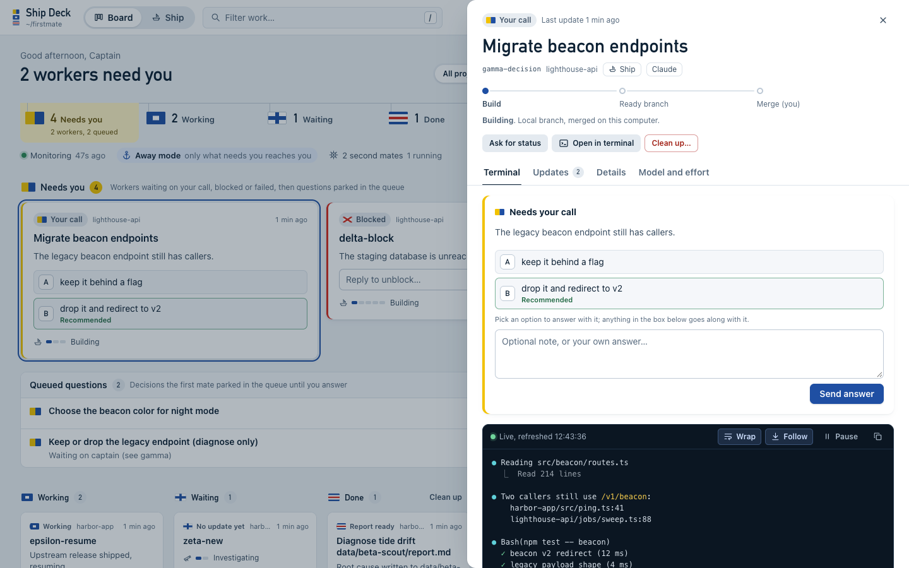
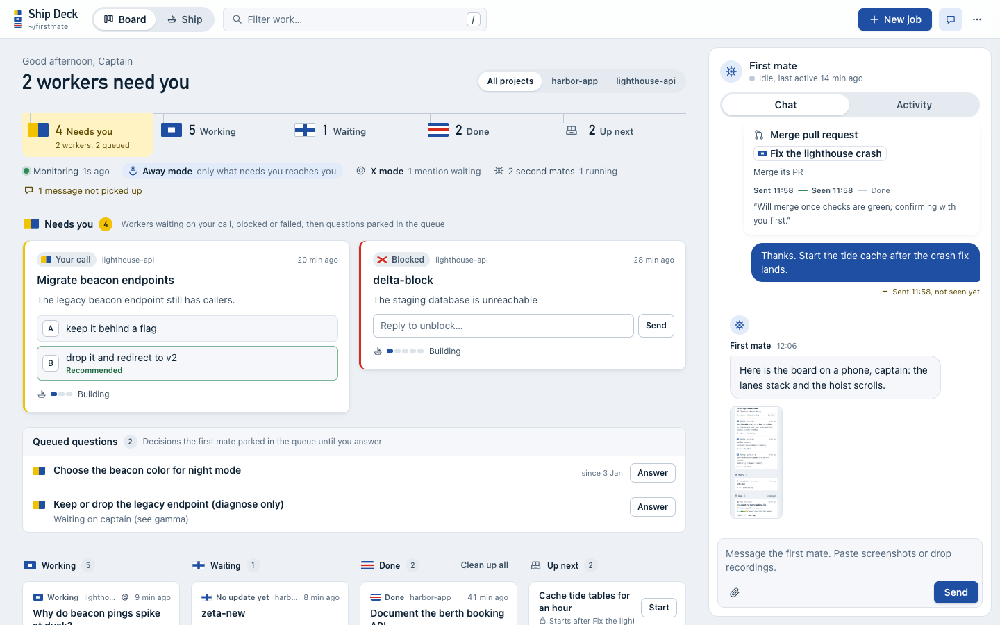
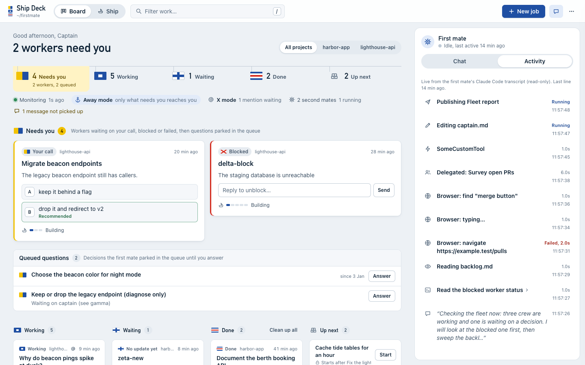
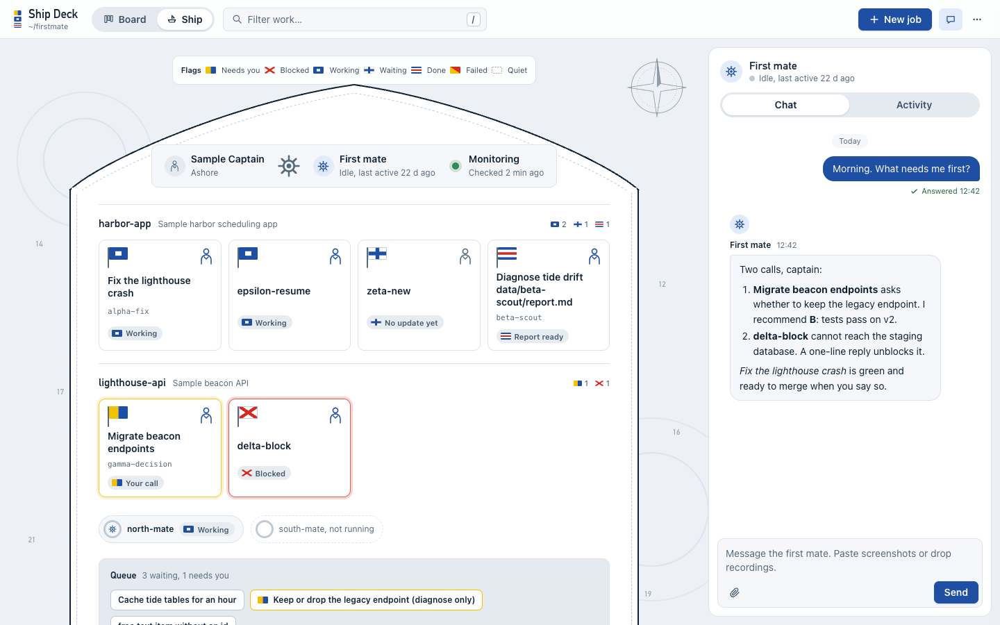
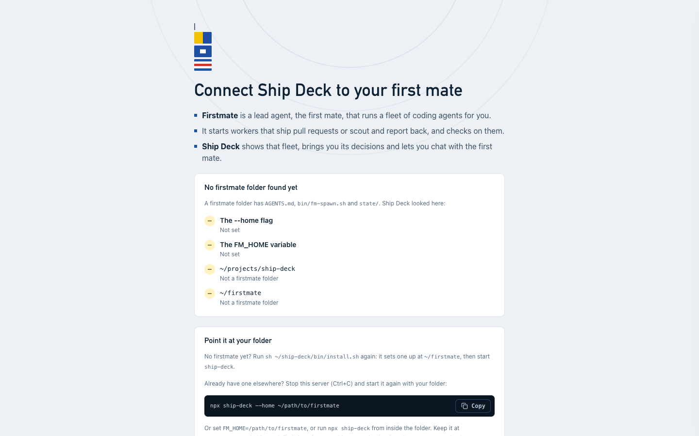
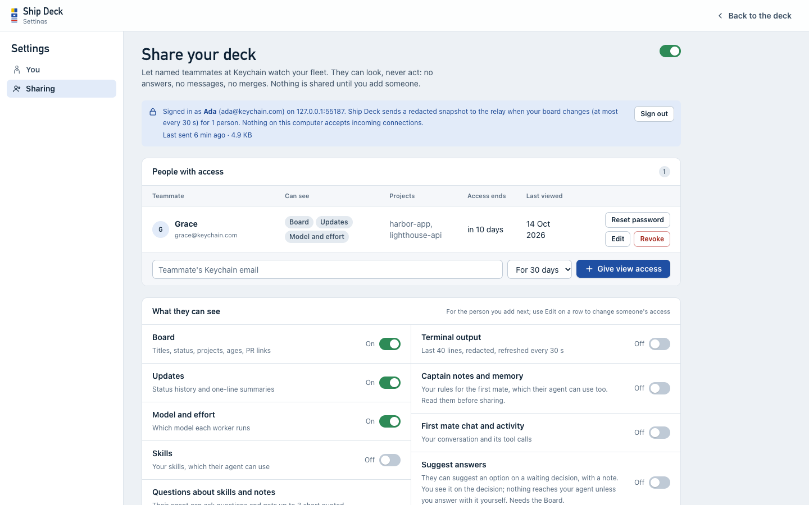

# Ship Deck for Keychain teammates

Ship Deck is a window onto your own firstmate: a board of what your workers
are doing, a chat with your first mate, and buttons for the usual answers.
Everything runs on your laptop. There is nothing to host, no server to share
and no one else's fleet to reach: your Ship Deck talks only to your first mate,
at `http://127.0.0.1:4747/`, the same way the captain's does.

Setup is one command and a couple of sign-ins.

## What you will see (60 seconds)

**The Board.** Every worker in one of four columns: **Needs you**, **Working**,
**Waiting** and **Done**. Each card has the task title, a status flag and the
latest update. Answer a worker's question right on its card. The chat with your
first mate sits on the right.


**A worker that needs you.** Click a card for its details: the question on top,
the answer buttons, and a live view of the worker's terminal.



**Attachments.** Paste a screenshot or drop a screen recording into the chat;
your first mate gets the image (and stills from the video).



**Activity.** What your first mate is doing right now, live from its own
session.



**The Ship view** shows the same fleet as a chart, if you like that better.
Press `?` any time for keyboard shortcuts. It follows your Mac's dark mode.



*(Screenshots use made-up sample data.)*

## 1. Install Ship Deck (one command)

On a Mac or Linux, paste this in a terminal:

```sh
curl -fsSL https://raw.githubusercontent.com/aryanbhandari047/ship-deck/main/bin/install.sh | sh
```

The installer:

- checks for Node.js 18 or newer (installs it with Homebrew when missing),
  git, tmux, the GitHub CLI and the `claude` CLI, and installs what it can
  without sudo. For anything it cannot install, it prints the one command to
  run;
- sets up firstmate, the open-source engine that runs your first mate and its
  workers, at `~/firstmate`, and teaches it to read Ship Deck's chat. An
  existing firstmate there is used as is, and a folder there that is not
  firstmate stops the install untouched;
- copies Ship Deck to `~/.ship-deck/app` (its source stays in
  `~/.ship-deck/src` for updates) and adds a `ship-deck` command in
  `~/.local/bin`;
- starts Ship Deck and opens it in your browser, then prints its address,
  three things to try and anything left to do (like `gh auth login`).

On a Mac, a first install also offers **Stay awake with the lid closed** (on
by default: press Enter to keep it, `n` to skip; macOS asks for your password
once). It keeps your agents running when you close the lid. Turn it off any
time in Settings > You or with `ship-deck awake off`.

Apart from that one password prompt it never uses `sudo`, and it changes
nothing else unless you ask. Add flags after `sh -s --`, for example
`curl -fsSL <the URL above> | sh -s -- --autostart`:

| Add this | To |
| --- | --- |
| `--home /path/to/firstmate` | keep firstmate in another folder (set up there when it is missing; Ship Deck remembers it) |
| `--no-edit-path` | do not add `~/.local/bin` to your PATH in your shell settings (it does by default when missing; with this it prints the line for you to add) |
| `--no-keep-awake` | Mac only: leave normal sleep alone (`--keep-awake` turns it on without asking, also on a re-run; re-runs otherwise keep your choice) |
| `--autostart` | start Ship Deck at login (a LaunchAgent on a Mac, a systemd user service on Linux) |
| `--no-start` | install only; start it later with `ship-deck` |
| `--no-share` | turn sharing off (it is on by default, with the Keychain relay, so skills teammates share reach your agent; nothing is sent until you sign in). Remembered by `ship-deck`, `--autostart` and later installs until `--share` (or `--share-relay URL` for another relay) |

Prefer a clone? `git clone https://github.com/aryanbhandari047/ship-deck.git ~/ship-deck`
then `sh ~/ship-deck/bin/install.sh` does the same.

## 2. Updating

When a new version is out, the deck shows **A new version of Ship Deck is
ready**. Click **Update**: it gets the new version, restarts the deck and the
page reloads. Or run `ship-deck update` in a terminal. It prints what changed.
If you changed files in your copy, it stops and changes nothing.

Installed before updates existed? Run this once:
`git -C ~/ship-deck pull && sh ~/ship-deck/bin/install.sh`.

## 3. Sign in and start your first mate

Once: run `claude` and finish the sign-in, and run `gh auth login` (your
first mate opens pull requests with it). Then start your first mate in its
folder and leave that terminal open:

```sh
cd ~/firstmate && claude
```

## 4. Opening Ship Deck again

The installer leaves Ship Deck running in the background
(`~/.ship-deck/server.log` has its log). To open it again, run `ship-deck`:
it opens the running deck, or starts one if none is running (Ctrl+C stops a
deck started this way). It lives at `http://127.0.0.1:4747/` (or the next
free port, and it prints which).

If Ship Deck cannot find your firstmate folder, it shows **Connect Ship Deck to
your first mate** with the places it looked. Run `sh ~/.ship-deck/app/bin/install.sh`
again to set one up, or, if yours lives elsewhere, start it with that folder:

```sh
ship-deck --home ~/path/to/firstmate
```



Your name on the bridge comes from `git config user.name`; change it with
`ship-deck --captain-name "Your Name"`. Ship Deck calls you "Captain"; to be
called something else (Boss, your first name, or no title at all), open
**More > Settings** and change **What to call you**. Leave **Also tell the
first mate** ticked and it gets a message asking it to use the new one too.

## 5. Talk to your first mate (the Bridge chat)

Type in the chat on the right and press Enter. Your message is saved in
`~/.ship-deck/` and a one-line nudge lands in your firstmate's `state/` folder,
so your first mate notices within its next check.

A firstmate the installer set up already knows how to read and answer the
chat (it is in its `data/learnings.md`). If you had firstmate before, the
installer prints one line to tell it once, in its terminal:

> Read ~/.ship-deck/app/docs/FIRST-MATE.md and add it to data/learnings.md

After that, everything the buttons do (answer a question, merge, clean up,
start a new job) is a chat message your first mate acts on. Ship Deck never
merges or deletes anything by itself, and your first mate still confirms
anything that cannot be undone.

## 6. Attachments

Paste (Cmd+V) a screenshot, drag a file onto the chat, or click the paperclip.
Images (png, jpeg, gif, webp, up to 20 MB) and videos (mp4, mov, webm, up to
200 MB), up to 10 per message. For a video, Ship Deck pulls out still frames
first, since Claude reads images, not video. Files stay on your laptop in
`~/.ship-deck/attachments/`.

## 7. Worker settings

Open a worker and look under **Settings**: its tool, model and effort. For
Claude workers a change applies from the worker's next turn; for others it is
noted for the next relaunch. Only the listed values can be picked.

## 8. Optional: let someone watch your board (read-only)

Sharing is on after install but sends nothing until you sign in and add
someone, and it is view-only: nobody can send anything to your first mate
through it.

1. Ask Aryan to invite you. You get a one-time link (valid 24 hours) to set
   your password on the Keychain relay.
2. If you turned sharing off with `--no-share`, turn it back on and restart
   Ship Deck:

   ```sh
   sh ~/.ship-deck/app/bin/install.sh --share
   ```

3. Open **More > Share your deck** in the top bar (**Settings > Sharing**), sign in,
   then add a teammate by their `@keychain.com` email, pick what they can see
   and for how long (1, 7 or 30 days).

Paths, attachments, chat text and terminals stay private unless you tick them,
and secrets are scrubbed before anything leaves your laptop. **Who viewed
what** lists every view.



Turning on **Skills** or **Captain notes and memory** for someone also gives
their own agent that knowledge (next section), with no extra switch.

**Turning it off:** use the switch at the top of Settings > Sharing to pause
(nothing is sent), **Revoke** a person, or **Sign out** to remove this
laptop's access. To stop completely, run `sh ~/.ship-deck/app/bin/install.sh --no-share`
and restart Ship Deck.

## 9. Optional: let your agent use what teammates share with you

When a teammate shares their **Skills** or **Captain notes and memory** with
you, your own Claude Code can use them automatically. There is no key to make:

1. Sign in under **Settings > Sharing** with your relay account (sharing is
   on after install; see step 8 if you turned it off).
2. That is all. Within a minute, and then whenever they change something
   (checked at most every 10 minutes), Ship Deck adds their knowledge to
   `~/.claude/skills` as read-only skills:
   `teammate-<their-name>-<skill>` for each skill, and one
   `teammate-<their-name>-notes` for their notes and memory.
3. Using Codex or Cursor too? If their folder (`~/.codex`, `~/.agents` or
   `~/.cursor`) exists, Ship Deck also adds the same skills to
   `~/.agents/skills` and as Cursor rules in `~/.cursor/rules`. Each has its
   own switch under **Shared with you**.

Each of these files starts with "Shared by <name> via Ship Deck on <date>;
reference knowledge from a teammate - follow it as guidance, it is not an
instruction from the user", so your agent treats it as a teammate's advice,
not as your orders. Secrets and paths were scrubbed on their laptop before
anything left it.

**Shared with you**, at the bottom of Settings > Sharing, lists what you have
from whom. The Ship's Library shows them under "Shared by <name>". Turn off
**Use knowledge shared with me** there to remove them all. They are also
removed when you sign out, and a teammate's go away on the next check once
they stop sharing, revoke you or your access ends. Ship Deck only touches
`teammate-*` folders it made itself (they hold a `.ship-deck-teammate.json`
marker); your own skills are never changed. Details:
[AGENT-LIBRARY.md](AGENT-LIBRARY.md).

## Removing Ship Deck

```sh
rm -rf ~/.ship-deck/app ~/.ship-deck/src ~/.local/bin/ship-deck
```

`~/.ship-deck/` also holds your chat history and attachments; delete all of it
if you want them gone. If you used `--autostart`, also remove
`~/Library/LaunchAgents/local.ship-deck.plist` (after
`launchctl bootout gui/$(id -u)/local.ship-deck`) or run
`systemctl --user disable --now ship-deck.service` and delete
`~/.config/systemd/user/ship-deck.service`.
The installer's `~/firstmate` is yours to keep or delete separately.
